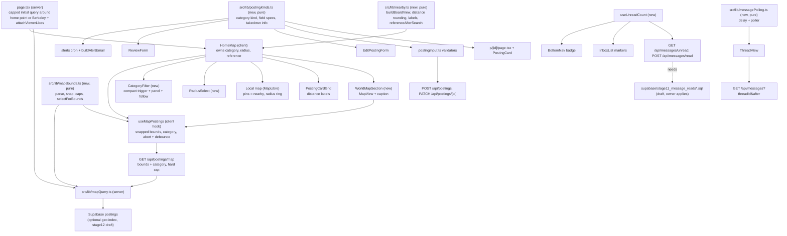
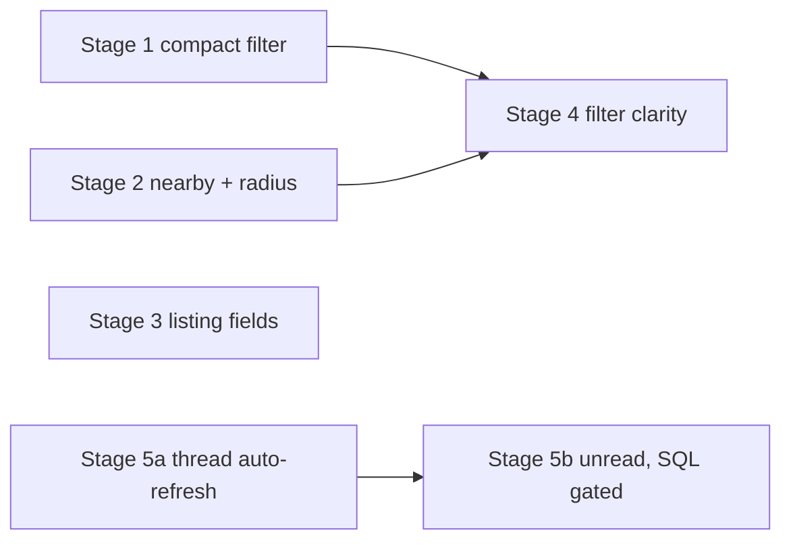
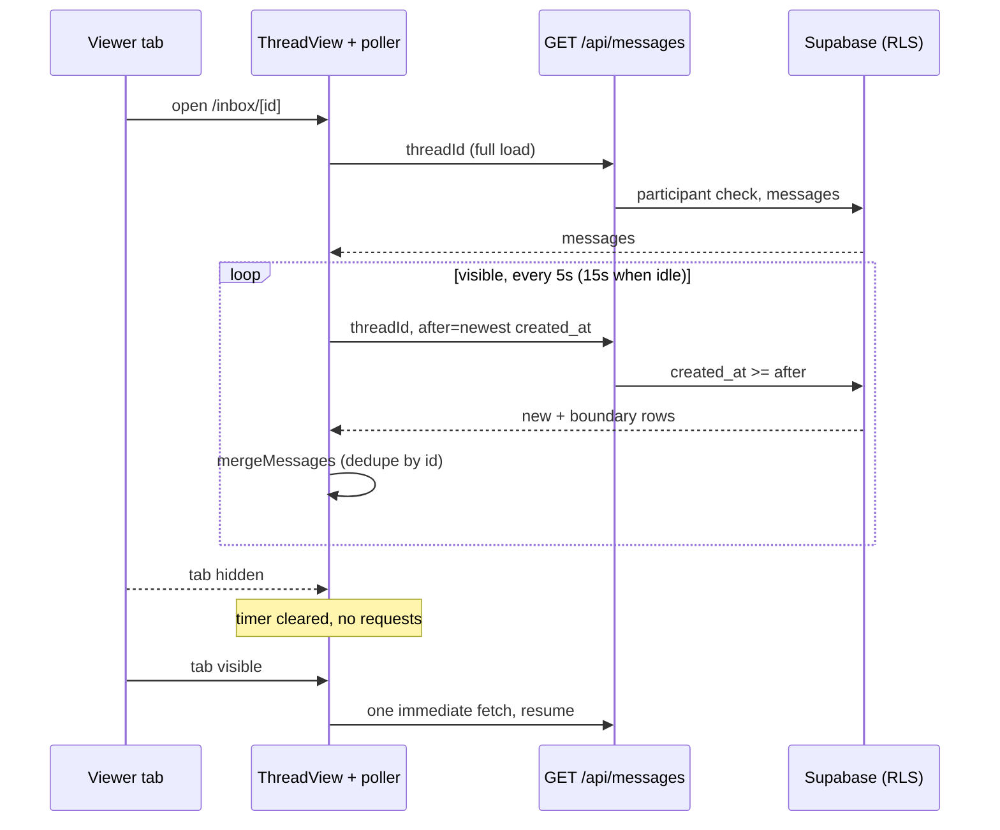

# Design Document: Board Usability Improvements

## Overview

Five usability fixes to the signed-out and signed-in board, delivered as five stages that can each be built, verified and released on their own:

1. **Compact category filter** so the map is visible sooner on a phone (390 px) without losing filtering or category following.
2. **Nearby results with a radius**: every card in "On your doorstep" shows a rounded distance, a radius control sets the cut-off (default 10 miles), and the label, the map pins and the cards always describe the same set. After a place search, the searched place is the centre for nearby results.
3. **Category-specific posting fields**: events keep date, time and RSVP. Jobs, Housing and Real Estate, Sales, and Lost and Found get an optional deadline and a suitable action link. **Community supports both events and general notices**: its event date is optional, and a posting without one uses the chosen posting duration. Expiry is explained the same way in the form, the detail page and the edit flow. The alert job is checked and fixed for listings and date-less Community postings.
4. **Map filter clarity and a bounded world map**: the category filter applies to both the local map and "Explore the world", and neither map loads every posting into the browser. Both read from one server-capped, bounds-limited query, with a "zoom in to see more" state when the cap is hit.
5. **Messages**: an open thread refreshes itself (visibility-aware, with backoff and no duplicates). An unread indicator is designed as a reviewed, additive SQL draft, because the current data model cannot support it safely.

The design is written in TypeScript because the project is Next.js 15 (App Router), React 19 and Supabase. Tests use vitest and fast-check (already dev dependencies).

### Findings from reading the code

| Area | What the code does today | Consequence |
|---|---|---|
| Home layout | `src/app/page.tsx` renders cork band, two action buttons, then `HomeMap`. `HomeMap` renders the town search, "Use my location", **all 10 category chips each with a Follow button**, then the `h-64` map. | On a phone the chips push the map below the fold (Stage 1). |
| Rail contents | `HomeMap` filters `postings` by category only. `listActivePostings()` returns every active posting in the database, and `drawPins` draws all of them. | A Richmond posting shows under a Berkeley search because nothing filters by place (Stage 2). The map pins have the same flaw. |
| World map | `page.tsx` renders `<MapView postings={postings}/>` separately, with the unfiltered list. `MapView` also rebuilds the whole map whenever `postings` changes. | Sports hides Community locally but not worldwide (Stage 4). |
| Data volume | `listActivePostings()` in `src/lib/postings.ts` selects every non-deleted, non-expired row with no `.limit()`, no bounds and no order, then runs `withCounts` over all of them. `page.tsx` calls it once and ships the whole array to `HomeMap` and `MapView` as props (and into the HTML as serialised props). `follows.ts` calls it too. PostgREST applies the project's `max-rows` (Supabase default 1000) silently, so past that size the map would drop postings with no warning. | The page cost grows with the whole database, and the failure mode at the limit is silent data loss. Stage 4 replaces this with a capped, bounds-limited query. |
| Alert job | `src/app/api/cron/alerts/route.ts` selects `event_date, end_date, end_time, event_time` and passes them to `alertMatchesPosting` (via `isPostingActive`) and to `buildAlertEmail`. The match path already carries `endDate` and `endTime`. `buildAlertEmail` in `src/lib/email.ts` reads only `eventDate` and `eventTime`, and prints "Date: see posting" otherwise. The route does not pass `endDate` to the email at all. | Matching should already be correct for a listing deadline (stored in `end_date`) and for a date-less Community posting (falls back to `expires_at`), but it needs a test. The email shows no deadline for a listing (Stage 3). |
| Posting form | `ReviewForm` and `EditPostingForm` always show Event date, Time, End date, End time, Event place and "RSVP link". `validatePostingInput` and `validatePostingEdit` treat the fields the same for every category. | Listings are asked for event data (Stage 3). |
| Lifecycle | `postingTakedown` = earlier of `expires_at` and event end, where event end = `endDate ?? eventDate` at `endTime ?? 23:59:59.999` in the posting's stored zone. The SQL `posting_takedown_at` uses `coalesce(end_date, event_date)`, so **a posting with only `end_date` already works in both app and database**. | Listing deadlines need **no schema change** (Stage 3). |
| Edit | `PATCH /api/postings/[id]` always writes `event_date`, `event_time`, `end_date`, `end_time` from the payload. | Edit must write the right columns for the category kind and must not erase data without telling the owner. |
| Threads | `ThreadView` loads on open, on focus, on visibility, and on a button. `GET /api/messages?threadId=` returns the whole thread. `mergeMessages` already dedupes by id. | Polling can reuse the merge, plus a cursor (Stage 5). |
| Unread | `messages` has no read state. `message_threads` has no per-user columns. `stage3_messaging.sql` and `stage6_social_part4.sql` add no read tracking, and clients have no UPDATE privilege on either table. | Unread needs a new table, so it is a draft SQL stage (Stage 5b). |

### Constraints that apply to every stage

- Steering rules apply: Paper `#FFFDF8`, Ink `#1E1E1C`, dark red `#8C2B1F`, deep navy `#1F2E4D`, Kalam, 50 px primary controls, 13 px card corners. **Exactly one dark-red main action per screen.** Selected chips are dark red. Secondary controls are navy or neutral. No fifth colour.
- MapLibre real maps, tan background, dark-red pins. The viewer's own dot stays navy.
- The user's exact location is never shown publicly. The viewer's exact reference point (device location or searched place) stays in the browser and is never sent to the server. The map query sends only **viewport bounds snapped outward to a 0.1° grid (about 11 km)**, the same information any map tile request reveals, and the server neither stores nor logs it with a user id. Username is the only public name.
- Follow and Connect stay independent. There is no Like on replies or messages.
- SQL is additive only. Kiro writes drafts with preflight, verify and rollback files (same shape as `stage9_category_follows*.sql`). **The owner reviews and applies them. Kiro does not apply SQL.** Existing postings are never modified by a migration.
- **Demo and verification postings live in test data only** (see Testing Strategy). They are never inserted into production and never added to `src/lib/seed.ts`, which real visitors can see when Supabase is not configured.
- The intermittent React #418 hydration issue (tracked in `BUILD_LOG.md`) is out of scope. New code must not make it worse: no `localStorage`, `window` or `Date.now()` reads during render. Read them in effects and render the server-safe default first.

## Architecture



### Stage dependencies



Stage 1 moves the category state and filter UI into reusable pieces. Stage 2 adds the place filter. Stage 4 then reuses both, adds the bounded map query, and moves the world map under the same state. Stage 2 loads its postings through the Stage 4 query, so the pure `mapBounds.ts` module and the `/api/postings/map` route are built first within Stage 2's work (Stage 2 can ship with the route and the nearby list, and Stage 4 adds the world map's viewport loading). Stages 3 and 5a touch disjoint files and can be reordered freely.

Two optional SQL drafts exist, both owner-reviewed and neither applied by Kiro: `stage12_postings_geo_index*.sql` (a performance index; the app works without it) and `stage11_message_reads*.sql` (unread messages; the app ships dark until applied).

## Stage 1: Compact category filter (mobile map visibility)

### Design

Replace the 10-chip grid with one control used at every width (one code path, one test matrix).

- **Trigger**: a navy-bordered white button, `Category: All` or `Category: Sports`, with a chevron. `aria-haspopup="true"`, `aria-expanded`, `aria-controls`.
- **Panel**: opens as an absolutely positioned popover under the trigger (`z-20`, `max-h-[60vh] overflow-auto`, width `min(100vw - 32px, 22rem)`). It overlays the map instead of pushing it. Closes on Escape, outside click, or selection. Focus returns to the trigger.
- **Panel rows**: "All categories", then each category in `CATEGORIES` order. Each row has a select button (selected row uses the dark-red selected style) and the existing `CategoryFollowButton` (renders nothing when signed out). Following keeps working exactly as in Stage 9: `PUT /api/category-follows/[slug]`.
- **Selected category**: the trigger shows the label. When a category is selected and the viewer is signed in, its Follow button also appears next to the trigger so following does not require opening the panel.
- **Header and rows**: the cork band subtitle is hidden below `sm`, and the greeting shares one line with the headline area. Search, "Use my location", Category and Radius sit in one wrapping row group under the search field. The map follows immediately.

### Layout targets (testable)

At **390 × 844** with the bottom nav fixed: the map container's top edge is at or above 55 % of the viewport height, and at least 240 px of the map is visible above the bottom nav without scrolling. At **1280 × 800**: the same controls appear in one or two rows, the map is visible, no horizontal scroll at either width. The baseline numbers are measured before the change and recorded in `BUILD_LOG.md`.

The map height becomes `h-72 sm:h-96` (from `h-64`) so the map is larger once visible.

### Components and interfaces

```typescript
// src/components/ui/CategoryFilter.tsx  ("use client")
export interface CategoryFilterProps {
  value: string | null;                 // category slug, or null = all
  onChange: (slug: string | null) => void;
  followed: string[];                   // slugs the viewer follows
  signedIn: boolean;
}
export function CategoryFilter(props: CategoryFilterProps): JSX.Element;

// src/lib/nearby.ts (pure)  -- shared with Stages 2 and 4
export function filterByCategory(postings: Posting[], slug: string | null): Posting[];
```

`HomeMap` keeps `activeCategory` state and passes it to `CategoryFilter`. `CategoryChip` is unchanged and is still used by the form chips, the card chip and the panel's selected row.

### Behaviour notes

- Keyboard: Tab reaches the trigger; Enter or Space opens; arrow keys are not required, but every row is a normal button in tab order. The panel is a `role="group"` with an accessible name.
- `aria-pressed` on each select button reflects selection, matching the current chip behaviour.
- Panel contents are rendered only while open, so a closed filter adds no follow buttons to the tab order.

## Stage 2: Nearby results, distance and radius

### Design

The exact radius test and the distance labels run in the browser. The viewer's exact reference point never leaves the browser. The candidate postings come from the bounded map query described in Stage 4 (`mode=cards`): the client asks for the snapped bounding box of the radius circle and then applies the exact haversine test, so the list is bounded by radius on the server as well as in the browser.

**Centre after a place search (rule).** When the viewer searches for a town or place and picks a result, that place becomes the reference point (`kind: "town"`, `name` = the searched place). From that moment, nearby results, distances, the radius ring, the heading and the empty state all use that place as the centre, regardless of where the viewer's device is or where the map is panned. The reference changes only when the viewer searches again, uses "Use my location", or reloads (the saved centre is restored). Panning and zooming never change it. `referenceAfterSearch(result)` is the single pure function that builds this reference, so the rule has one implementation and one property test.

**Reference point** (what distance is measured from), chosen by the same order `HomeMap` already uses to centre the map. The most recent explicit action (a search or "Use my location") wins over saved and default values:

| Kind | When | Label text |
|---|---|---|
| `town` | the viewer searched a town | the typed town name, for example "Berkeley" |
| `device` | device location was granted (auto or "Use my location") | "your location" (coordinates are never shown) |
| `home` | signed-in alert home point | the alert town name, else "your alert home" |
| `saved` | a saved centre with no name | "your saved map area" |
| `default` | nothing else | "Berkeley" |

`SavedCenter` in `localStorage` gains an optional `kind` field. A saved value without `kind` is read as `town` if it has a town name, otherwise `saved`. Old values keep working.

**Radius**: options `1, 3, 5, 10, 25` miles, default **10 (confirmed by the owner)**. The default is a single constant (`DEFAULT_RADIUS_MILES`). It stays inside the 1 to 25 mile range the alerts feature already uses. The choice is saved in `localStorage` under `corkback.radiusMiles`. Any saved value not in the option list is ignored. 10 miles covers a typical town and its neighbours, so a Richmond posting under a Berkeley search is shown. Two things make that understandable: the heading always states the radius and the centre ("Within 10 mi of Berkeley"), and each card shows its own approximate distance ("About 8.5 mi away"). A narrower radius hides it.

**One source of truth**: a single pure function builds the view, and both the pins and the cards read from its result, so they cannot disagree.

```typescript
// src/lib/nearby.ts
export const RADIUS_OPTIONS_MILES = [1, 3, 5, 10, 25] as const;
export const DEFAULT_RADIUS_MILES = 10;
export const METERS_PER_MILE = 1609.344;

export type ReferenceKind = "town" | "device" | "home" | "saved" | "default";
export interface BoardReference { lat: number; lng: number; kind: ReferenceKind; name: string | null }

export interface NearbyItem {
  posting: Posting;
  /** Rounded, display-safe label such as "About 2.5 mi away". */
  distanceLabel: string;
}
export interface BoardView {
  nearby: NearbyItem[];   // category AND within radius, sorted
  radiusMiles: number;
  referenceLabel: string; // for the heading, for example "Berkeley"
  truncated: boolean;     // the server cap was hit for this radius (Stage 4)
}

/** The reference a place search produces. Pure; the only way a search sets the centre. */
export function referenceAfterSearch(result: { lat: number; lng: number; name: string }): BoardReference;

export function parseRadius(raw: unknown): number;                    // option value or DEFAULT
export function milesBetween(a: LatLng, b: LatLng): number;           // haversineMeters / METERS_PER_MILE
export function roundApproxMiles(miles: number): number;              // see below
export function formatApproxDistance(miles: number): string;
export function referenceLabel(ref: BoardReference): string;
export function radiusPhrase(radiusMiles: number, ref: BoardReference): string; // "Within 10 mi of Berkeley"
export function buildBoardView(
  postings: Posting[],
  opts: { category: string | null; reference: BoardReference; radiusMiles: number; truncated?: boolean },
): BoardView;
```

### Distance rounding (privacy)

The displayed distance is deliberately coarse. A pin is already within 150 m of the poster (`MAX_NUDGE_METERS`), and the label adds no precision.

```typescript
export function roundApproxMiles(miles: number): number {
  if (miles < 0.5) return 0;               // shown as "Under 0.5 mi away"
  if (miles < 10) return Math.round(miles * 2) / 2;   // nearest half mile
  return Math.round(miles);                           // nearest whole mile
}
export function formatApproxDistance(miles: number): string {
  const r = roundApproxMiles(miles);
  if (r === 0) return "Under 0.5 mi away";
  return `About ${Number.isInteger(r) ? r : r.toFixed(1)} mi away`;
}
```

Midpoints round up (2.25 becomes 2.5, 9.75 becomes 10, 12.5 becomes 13), which `Math.round` does for non-negative values. A distance under 0.5 mi reads "Under 0.5 mi away". **Membership uses the true distance** (`miles <= radiusMiles`). Because every radius option is a whole number and the rounding grid contains every whole number, an included posting never displays a distance above the radius (property P6).

**Ordering**: promoted postings first (the existing `orderWithPromoted` rule), then nearest first within each group. Ties break on posting id so the order is stable.

### Map, label and rail agreement

- `HomeMap` calls `buildBoardView` in a `useMemo` keyed on `[postings, category, reference, radiusMiles]`.
- Local map pins are drawn from `view.nearby`. The rail renders `view.nearby`. The heading line reads `"{n} posting(s) · Within {r} mi of {reference}"`, from the same object.
- A navy dashed ring (a GeoJSON line layer built with the existing `circlePolygon`) shows the radius on the map. It is a different layer and colour from the viewer's accuracy fill, and it carries no coordinates in text.
- On a **town search** or a **radius change** the map fits the ring (`fitBounds`, padding 24, `maxZoom: 15`). On **device location** the existing street-level zoom is kept (that behaviour was deliberate in an earlier stage), and a navy "Show full radius" button refits the ring. The button shows only while the reference is `device` and the viewer has not since searched a place or changed the radius. Panning or zooming never changes the reference.
- Empty state (cork band, as today): "Nothing within 10 mi of Berkeley." One navy button offers the next larger radius, labelled "Try {next} mi" (1 to 3, 3 to 5, 5 to 10, 10 to 25). Activating it sets and saves that radius and recomputes the heading, ring and list. At 25 mi the empty state reads "Nothing within 25 mi of {place}" and shows no button. The button is not dark red, because Scan a flyer is the screen's one main action.
- The first render uses the server-safe reference (`homePoint ?? Berkeley`). The saved centre is applied in the existing mount effect, as `HomeMap` does today, so server and client markup match on first render.

### Card change

`PostingCard` gets an optional `distanceLabel?: string`, rendered in the metadata line after the date and place. `PostingCardGrid` gets an optional `distanceLabels?: Record<string, string>` keyed by posting id. Other callers (profiles, Following) pass nothing and are unchanged. Screen-reader text is "about 2 and a half miles away" via `aria-label` on the label span only when the visible text would read poorly.

### Loading nearby postings (bounded, replaces "load everything")

The first draft of this design filtered the full active list in the browser. That is replaced: the doorstep list is bounded by radius **before** it reaches the browser.

- `page.tsx` runs the capped bounds query (Stage 4, `mode=cards`) for the snapped box around `homePoint ?? Berkeley` at `DEFAULT_RADIUS_MILES`, and passes that as the initial `postings` prop. Server and client first render use the same reference, so there is no hydration mismatch.
- When the reference (search, device location, saved centre) or the radius or category changes, `HomeMap` calls `useMapPostings` for `snapBoundsOutward(boundsForRadius(reference, radius))`. The exact reference never goes in the request. The request carries only the snapped box and the category.
- The browser then applies the exact haversine test (`buildBoardView`) to the returned rows. Because the box contains the circle, no posting inside the radius is lost unless the cap was hit.
- If the cap (`MAP_CAPS.cards`, 100) was hit, `view.truncated` is true and the rail shows "Showing the first 100 postings. Choose a smaller radius to see them all." The list never silently drops results.
- Rows come back ordered promoted first, then newest. The nearest-first order is applied in the browser to the returned set. Under truncation the returned set is not guaranteed to be the nearest 100. That is why the notice recommends a smaller radius.

## Stage 3: Category-specific posting fields

### Category kinds

```typescript
// src/lib/postingKinds.ts (pure)
export type PostingKind = "event" | "listing" | "event-optional";
export const LISTING_SLUGS = ["jobs", "housing", "sale", "lost-found"] as const;
export const EVENT_OPTIONAL_SLUGS = ["community"] as const;

/** listing if in LISTING_SLUGS, event-optional if in EVENT_OPTIONAL_SLUGS, else event. */
export function categoryKind(slug: string): PostingKind;

export interface FieldSpec {
  kind: PostingKind;
  /** Event date, time, end date and end time are shown (event, event-optional). */
  showsEventFields: boolean;
  /** The event date is required to submit (false for event-optional and listing). */
  eventDateOptional: boolean;
  deadlineLabel: string | null;     // listings only
  deadlineHint: string | null;
  cardPrefix: string | null;        // card line, e.g. "Apply by"
  actionLabel: string;              // form label for the single link
  actionHint: string;
  actionButton: string;             // public button text
}
/** hasEventDate matters only for event-optional: "RSVP" with a date, "Learn more" without one. */
export function fieldSpec(slug: string, opts?: { hasEventDate?: boolean }): FieldSpec;
```

Whether a plain event category requires an event date today is decided by the existing validators, and this stage does not change it. The `eventDateOptional` flag exists so that Community can say "optional" in the form without altering the other event categories.

| Category | Kind | Dates in the form | Link field and public button |
|---|---|---|---|
| Music, Nightlife, Sports, Social Clubs, Classes | event | Event date, Time, End date, End time (unchanged) | "RSVP link (optional)", button **RSVP** |
| Community | event-optional (events **and** general notices) | "Event date (optional)", Time, End date, End time. Time, End date and End time need an event date. | "Link (optional)". Button **RSVP** when an event date is set, **Learn more** when it is not |
| Jobs | listing | "Apply by (optional)" | "Application link (optional)", button **Apply** |
| Housing and Real Estate | listing | "Available until (optional)" | "Listing or contact link (optional)", button **View listing** |
| Sales | listing | "Offer ends (optional)" | "Listing link (optional)", button **View listing** |
| Lost and Found | listing | "Keep this up until (optional)" | "Contact link (optional)", button **Contact** |

**Community (owner decision).** Community covers both events (a neighbourhood meeting, a yard sale day) and general notices (a lost cat photo call, a petition). A third kind, `event-optional`, models it: it is not a flag on `event`, because the validators, form, expiry preview and card each branch on it, and a named kind makes `switch` exhaustiveness checks catch a missed branch. The mapping is one constant per kind, so moving a slug later is a one-line change.

**Community expiry rule.** One rule, implemented by the existing lifecycle function with no change to it:

- **Event date supplied**: event expiry, the same rule as the other event categories. The posting comes down at the earlier of the chosen expiry and the end of the event (`endDate ?? eventDate` at `endTime ?? 23:59:59.999` in the stored zone).
- **No event date**: the posting stays up for the **selected posting duration** (the existing expiry choice, which sets `expires_at`).

`postingTakedown` and the SQL `posting_takedown_at` already return `expires_at` when `event_date` and `end_date` are both null, so Community notices need no schema or lifecycle change.

**Housing "available from" (owner decision).** Housing keeps one optional date, "Available until", used as the deadline. A move-in or "available from" date stays in Details as free text for this stage. A structured "available from" field can be added later if housing becomes a major use case. It would need its own column (the deadline reuses `end_date`) and is deliberately not designed here.

### Storage: no schema change

- The **deadline is stored in `end_date`**, with `event_date`, `event_time` and `end_time` all null. The lifecycle rule already ends a posting at the end of `coalesce(end_date, event_date)` in the stored zone (TypeScript `eventEnd`, SQL `posting_takedown_at`). The existing check `end_date >= event_date` allows a null `event_date`.
- The **action link stays in the `rsvp_url` column**. Only the label and button text vary. The one-link, http(s)-only rule (`parseRsvpUrl`) is unchanged. Code names it `actionUrl` in new helpers and keeps `rsvpUrl` in existing types to avoid churn.
- Rejected alternatives: a new `deadline` column (adds a migration for no behavioural gain), a `kind` column (derivable from the category), and a database check that forbids event dates on listing categories (a CHECK cannot read `categories`, and a trigger would risk existing rows).

### Validation (publish and edit)

For a listing slug, `validatePostingInput` and `validatePostingEdit` use a different branch of the same functions:

- Accept `deadline` (ISO date, optional). Return `endDate = deadline`, `eventDate = null`, `eventTime = null`, `endTime = null`.
- If the payload carries `eventDate`, `eventTime` or `endTime`, reject with "Listings use a deadline instead of an event date." (No client sends these, so a request that does is stale or hand-made, and silent dropping would hide a mistake.)
- A deadline before today **in the posting's time zone** is rejected: "This deadline has already passed." The year-confirmation rule (`dateNeedsConfirmation` / `dateConfirmed`) applies to the deadline exactly as it does to the event date.
- Event categories behave exactly as today.
- **Community (`event-optional`)**:
  - No `eventDate`: valid. `eventTime`, `endDate` and `endTime` must also be null, otherwise reject with "Add an event date first, or clear the time fields." The stored row has all four date and time columns null and the posting uses the chosen expiry.
  - With `eventDate`: validated exactly like any event category (date not in the past in the posting's zone, year confirmation, `endDate >= eventDate`, end time rules). Event expiry applies.
  - The deadline field does not exist for Community, and a payload with `deadline` is rejected.
- **Edit of a Community posting.** The owner may add an event date to a notice, or change or remove one on an event. Removing the date while the posting has **already ended by its event** is rejected with "This posting has ended. Clearing its date would put it back on the board." Without that rule, clearing the date of an ended event whose `expires_at` is still in the future would revive it. Adding a date can only shorten the posting's life (the earlier-of rule), and the takedown line previews it before saving.
- The returned `ValidatedPosting` and `ValidatedEdit` shapes do not change, so `POST /api/postings` and `PATCH /api/postings/[id]` need no change to their inserts beyond what PATCH needs below.

`ExtractedFlyer.eventDate` from a scan of a listing flyer pre-fills the deadline. It is still year-checked, and the poster can clear it.

### Expiry is explained the same way everywhere

```typescript
export type TakedownReason = "expiry" | "deadline" | "event_end";
export interface TakedownInfo { at: Date; reason: TakedownReason }

/** Same rule as postingTakedown, plus which side won. kind decides "deadline" vs "event_end". */
export function takedownInfo(p: LifecycleFields & { categorySlug: string }): TakedownInfo;
```

For a Community posting, `reason` is `"event_end"` when an event date is set and its end is earlier than `expiresAt`, and `"expiry"` otherwise (including every date-less notice). It is never `"deadline"`, because Community has no deadline.

- **Review form**: under the expiry chips, "Comes down on {date}: {reason}". The date is the earlier of the chosen expiry and the deadline or event end. Before the pin exists the time zone is unknown, so the preview shows calendar dates and adds "The exact time uses your pin's time zone."
- **Detail page**: for an active posting, one line "On the board until {date}" followed by "(expiry)", "(deadline)" or "(event ends)". The page also renders the deadline row (calendar icon, the category's label) for listings. Ended postings keep the existing "This posting has ended" notice.
- **Edit form**: the same line shows the current takedown, plus the existing "Fixed after publishing" box. Editing a deadline recomputes the line. The expiry preset itself stays fixed, as today.
- **Card**: listings with a deadline show `"{cardPrefix} {date}"` (for example "Apply by Dec 1") where events show the date. A Community notice without an event date shows no date line at all (no "Date: null", no placeholder), and its metadata line starts with the place.
- **Detail page (Community)**: with an event date it looks like any event (date row, RSVP button, "On the board until … (event ends)" or "(expiry)"). Without one it shows no date row, the button reads "Learn more" when a link exists, and the line reads "On the board until {date} (expiry)".
- **Edit form (Community)**: the event date field is optional and clearable (subject to the ended-posting rule above). The takedown line recomputes as the date is added, changed or cleared, and a short note appears when the change shortens the posting ("Adding a date means this comes down when the event ends, if that is sooner.").
- **Database**: no change. `posting_takedown_at` (defined in `supabase/stage6_social_part1.sql`, signature `posting_takedown_at(timestamptz, date, date, time, text)`) already implements the rule. An isolated-database test compares it with `postingTakedown` for random listing rows (P15).

### Existing postings are not changed

- No migration. Existing rows stay exactly as stored.
- **Rendering shows what is stored.** If a listing-category posting already has an `event_date` or `event_time`, the detail page and card keep showing them as today. The deadline row appears only when `end_date` is set and `event_date` is empty. The action button shows the category's new label ("Apply" instead of "RSVP"), which is a display change only.
- **Edit of such a posting** opens with the deadline field pre-filled from the old event date and a notice: "This posting has an event date (Nov 16). Listings use a deadline instead. Saving replaces the event date with the deadline above." Saving then writes `end_date`, and sets `event_date`, `event_time` and `end_time` to null. Nothing changes unless the owner saves.
- **PATCH** always computes all four date and time columns from the category kind (listing: only `end_date`, the others null; event: as today; event-optional: as an event when a date is given, all four null otherwise), so a kind switch in the edit form is saved consistently. Changing an event posting to a listing category drops its event times, and the form shows the same kind of notice before saving.

### Form behaviour

`ReviewForm` and `EditPostingForm` call `fieldSpec(category, { hasEventDate })` on every category or date change. For Community, the label reads "Event date (optional)" with the hint "Add a date if this is an event. Without one, your posting stays up for the duration you choose." Time, End date and End time are disabled until a date is entered, and clearing the date clears them from the payload (their typed values stay in state, as below). Hidden fields keep their typed values in state, so toggling the category back does not lose input, but only the fields of the current kind are sent. "Event place" stays for both kinds, relabelled "Place (optional)" for listings, with the existing hint that it is text, not the map pin.

### Stage 3 impact: alert job check (explicit, required)

The alert job must be checked, with tests, for any assumption that postings carry event fields. What was read while writing this design (`src/app/api/cron/alerts/route.ts`, `src/lib/alerts.ts`, `src/lib/email.ts`):

| Piece | Finding | Required action |
|---|---|---|
| Selection query | Reads `event_date, end_date, end_time, event_time, expires_at, time_zone`. | None. The columns cover listings (deadline in `end_date`) and date-less Community (all null). |
| `alertMatchesPosting` | Calls `isPostingActive(posting, now)` with `expiresAt, eventDate, endDate, endTime, timeZone`, so a listing with only `end_date` is active until the end of that day in its zone, and a date-less Community notice is active until `expiresAt`. | Add tests (P28, P29). No code change expected. If a test fails, fix `alerts.ts` to use the shared lifecycle rule, not a copy. |
| Email payload | The route builds the email object from `event_date` and `event_time` only and drops `end_date`. | Pass `endDate` and `categorySlug` through. |
| `buildAlertEmail` | `dateLine` uses `eventDate` and `eventTime`, else "Date: see posting". A listing with a deadline therefore shows no date, and the wording says "Date" for everything. | Use `fieldSpec(slug).cardPrefix` for listings: "Apply by Dec 1". Events keep "Date: …". Date-less Community and listings with no deadline omit the date line entirely, or say "Details: see posting". The line never contains `null`, `undefined` or "Invalid Date". |
| Unbounded read | The job loads every active posting, then loops alerts × postings. | Out of scope for this feature. Record it in `BUILD_LOG.md` as a scale follow-up. |

The check is a task in its own right: write the tests first, report anything surprising, and change only what the tests show is wrong.

## Stage 4: Map filter clarity and a bounded world map

### Today's data flow (inspected)

- `page.tsx` calls `listActivePostings()` once. That function selects all non-deleted, non-expired rows with no limit and no bounds (Findings table), runs `withCounts` over all of them, and the result is serialised into the page as props for both `HomeMap` and `MapView`.
- `MapView` makes one DOM marker per posting, and rebuilds the whole map when the array changes.
- Nothing in the code limits growth. At about a thousand rows, PostgREST's `max-rows` silently truncates the result. Before that, page weight, `withCounts` cost and DOM markers all grow linearly.

### Approach chosen: one capped, bounds-limited query ("zoom in to see more")

A new read-only endpoint, `GET /api/postings/map`, returns at most a **hard cap** of postings inside a bounding box, optionally for one category. Both maps use it. The world map re-queries as the viewer pans and zooms. The doorstep list queries the box around its radius circle (Stage 2).

**Alternatives considered**

| Option | Pros | Cons | Verdict |
|---|---|---|---|
| A. Capped bbox query (chosen) | Plain PostgREST filters, no SQL needed for correctness, same code serves the world map and the doorstep list, simple "zoom in" state, easy to test as a pure function | At low zoom it shows a sample, not everything. Needs an honest cap message | **Chosen** |
| B. Server-aggregated clusters per grid cell (RPC with `group by` on rounded lat/lng) | Shows the whole world at once with counts | Needs a new SQL function (reviewed draft), more UI (cluster markers, expand on click), and cluster counts must respect moderation and expiry rules inside SQL. More to get wrong for a board that is mostly local | Rejected for now. A later upgrade path if the world view needs counts |
| C. Load everything, cap in the browser | No new endpoint | Fails the requirement, since all rows reach the browser | Rejected |
| D. Pre-computed static tiles or vector tiles | Scales furthest | New infrastructure, stale data, large scope | Rejected |

**Why A.** CorkBack is a local board: most viewers care about what is near them. The world map is a secondary "where else" view, and a capped sample plus a clear "zoom in" is a correct and honest answer to it. A needs no schema change and reuses the stack the project already has (Next route handler, Supabase server client, MapLibre `moveend`).

### Contract

```typescript
// src/lib/mapBounds.ts (pure; shared by route, hook, page and tests)
export const MAP_CAPS = { pins: 300, cards: 100 } as const;   // hard caps per request, per mode
export const SNAP_DEGREES = 0.1;

export interface Bounds { west: number; south: number; east: number; north: number }
export interface MapPin { id: string; title: string; lat: number; lng: number; categorySlug: string }
export interface MapQueryResult<T> { items: T[]; truncated: boolean; cap: number }

/** "w,s,e,n" -> Bounds, or null if malformed: not 4 finite numbers, south >= north, west >= east, lat outside +-90, lng outside +-180. */
export function parseBounds(raw: string | null): Bounds | null;
/** Expands each edge outward to the next multiple of SNAP_DEGREES, clamped to the valid range. */
export function snapBoundsOutward(b: Bounds, step?: number): Bounds;
/** Smallest box containing the circle of radiusMiles around centre (handles longitude scaling by latitude). */
export function boundsForRadius(centre: LatLng, radiusMiles: number): Bounds;
export function pointInBounds(p: LatLng, b: Bounds): boolean;       // inclusive on all edges

/** Pure model of the server query. Seed mode and tests use it directly. */
export function selectForBounds<T extends { id: string; lat: number; lng: number; categorySlug: string; isPromoted?: boolean; createdAt: string }>(
  all: T[],
  q: { bounds: Bounds; category: string | null; cap: number },
): MapQueryResult<T>;
```

```typescript
// src/lib/mapQuery.ts (server only)
export async function queryPostingsInBounds(
  q: { bounds: Bounds; category: string | null; mode: "pins" | "cards" },
  now?: Date,
): Promise<MapQueryResult<MapPin | Posting>>;
```

**Endpoint** `GET /api/postings/map?bounds=w,s,e,n&category=slug&mode=pins|cards`

- Public (no account needed to browse). `bounds` is required and parsed with `parseBounds` (else 400). `category` must be a known slug (else 400). `mode` defaults to `pins` when omitted, and any value other than `pins` or `cards` is a 400 (zero postings, stored data unchanged). A data-source failure or timeout returns a server error status with zero postings, `Cache-Control: no-store` and no internal error detail. **The client cannot choose the cap**: the server uses `MAP_CAPS[mode]`.
- `pins` returns `MapPin[]` (marker fields only, no counts, no viewer data). `cards` returns full `Posting[]` with like and plan counts, and viewer likes when signed in.
- Query: `postings` rows with `deleted_at is null`, `moderation_hidden_at is null`, `expires_at > now`, `lat` between south and north, `lng` between west and east, an inner-join filter on `categories.slug` when a category is given, `order by is_promoted desc, created_at desc, id desc`, `limit cap + 1`. The extra row only detects truncation and is never returned.
- After the read, the existing lifecycle rule (`isPostingActive`) removes postings whose event has ended. If the raw read returned more than `cap` rows, `truncated` is true and the first `cap` active rows are returned. (A posting whose event ended but whose `expires_at` has not passed can use a cap slot and cause a false "zoom in" notice. This is harmless and rare, because most postings expire at or near their event end.)
- Counts (`withCounts`) and viewer likes run only for the returned rows, at most `cap`, not for the whole table.
- Headers: `pins` responses are viewer-independent and send `Cache-Control: public, s-maxage=30, stale-while-revalidate=60`. `cards` responses may include viewer likes and send `private, no-store`.
- Seed mode (`supabaseConfigured()` false): the same `selectForBounds` runs over `SEED_POSTINGS`, so local development behaves like production.
- The route validates and never echoes request values into HTML. It writes no per-user log of the bounds.

**Antimeridian.** The world map sets `maxBounds` to the world and `renderWorldCopies: false`, and the client clamps the box to `[-180, 180]`, so a request never wraps. A box that would wrap is rejected by `parseBounds`.

**Privacy of the request.** The box is snapped outward to 0.1° before it is sent (`snapBoundsOutward`), so it reveals roughly a town-sized area, not a point. Snapping also makes identical requests cache well. The exact device location or searched point is never in a request.

### Client behaviour

- `useMapPostings({ mode, category, bounds })` (client hook) fetches on mount and when the snapped box or category changes. For the world map, `bounds` come from the MapLibre `moveend` event, debounced 400 ms.
- One request in flight per hook: a new request aborts the previous one (`AbortController`), and a response whose sequence number is not the latest is ignored, so a slow old response never overwrites a newer view.
- `MapView` keeps a `Map<id, Marker>`. On new results it adds markers for new ids, removes markers for ids no longer present, and leaves the rest alone. It does not call `map.remove()` and does not refit on its own data changes after the first load, because refitting on every fetch would fight the viewer's panning.
- On request failure the map keeps its current pins and shows a quiet "Couldn't refresh this view. Try again" navy text button. It never blanks the map.

### Caps and states

| State | Condition | UI |
|---|---|---|
| Normal | `truncated` false | Caption "Explore the world · Sports · 3 postings in view" ("1 posting in view" when the count is 1) |
| Capped | `truncated` true | Caption "Showing 300 of many postings in this view. Zoom in to see more." The cap is a hard server limit |
| Empty | 0 items for the category in this view | "No Sports postings in this view." plus a navy "Show all categories" button and the hint "Pan or zoom out to look elsewhere." |
| Loading | request in flight | Previous pins stay. A small "Updating…" label shows after 300 ms |
| Error | request failed | Previous pins stay, retry button |

The doorstep list uses the same states with its own text (Stage 2).

### Category filter on both maps

The selected category is sent as `category` on both the local (`cards`) and world (`pins`) requests, so the cap is spent on the chosen category and never on pins that would be filtered out afterwards. The client also applies `filterByCategory` to results as a defence, so a stale in-flight response for the previous category cannot leak pins for a category that is no longer selected. "All categories" sends no `category`.

### SQL: not required, one optional additive draft

The approach needs **no SQL for correctness**: it uses existing columns and ordinary PostgREST filters. A btree range filter on `lat` and `lng` will scan more of the table as it grows, so one optional index is drafted as a **reviewed, additive stage** (the app works whether or not it is applied):

- `supabase/stage12_postings_geo_index_preflight.sql`: read-only. Reports the row count, whether `postings_active_geo_idx` exists, the column types of `lat` and `lng`, and the existing indexes.
- `supabase/stage12_postings_geo_index.sql`: `create index if not exists postings_active_geo_idx on public.postings (lat, lng) where deleted_at is null and moderation_hidden_at is null;`, one transaction, no insert, update or delete, safe to run twice (the second run leaves the same single index). (The owner may prefer `create index concurrently` outside a transaction on a large table. The draft says so in a comment.)
- `supabase/stage12_postings_geo_index_verify.sql`: confirms the index exists and is valid, and that the partial predicate matches the query's deleted and moderation-hidden filters.
- `supabase/stage12_postings_geo_index_rollback.sql`: `drop index if exists public.postings_active_geo_idx;` (no error when the index is absent, no row changed)

Kiro writes these drafts. The owner reviews and applies them. Kiro does not apply SQL. `expires_at > now()` is not part of the index predicate because `now()` is not immutable.

### Category filter clarity (original decision, unchanged)

**Apply the category filter to both maps.** The radius applies only to the local map. The "Explore the world" map is labelled with what it shows.

Why:

- The filter is one page-level control. A viewer who selects Sports and still sees Community pins on a map further down reads the page as broken, and a caption cannot fix a control that visibly does nothing.
- A worldwide map that ignores a filter has no use the other map lacks. With the filter applied, it answers "where else is Sports posted?", which is the reason to look at it.
- Showing all categories remains one tap away ("All categories").

Rejected: leaving the world map unfiltered with a label. It is less code, but the label would have to explain a behaviour that surprises people.

### Design

- `HomeMap` renders a `WorldMapSection` below the rail (the section moves from `page.tsx`, which stops rendering `MapView` itself). `WorldMapSection` owns the `useMapPostings({ mode: "pins" })` call for the viewport and passes the pins and a caption to `MapView`. `page.tsx` no longer loads world postings at all.
- Caption (pure function `worldCaption(categoryLabel | null, count, truncated)`): "Explore the world · All categories · 14 postings in view", "Explore the world · Sports · 3 postings in view", or the capped text from the states table. The radius does not apply here, and the caption says "in view" so it does not claim a worldwide total it does not have.
- When the category has no postings in the view: "No Sports postings in this view" with a "Show all categories" navy text button (see the states table).
- `MapView` must not rebuild the map when the filter or the pins change. It creates the map once and syncs markers by id in a second effect. The `[postings, router]` effect that calls `map.remove()` is replaced.
- The pins passed to `MapView` come from the hook state, so their identity is stable between unrelated renders.

## Stage 5: Messages

### 5a: Auto-refresh while a thread is open (no schema change)

**Behaviour**

- While a thread is open and the tab is visible, start the next poll **5 s** (±15 % jitter) after the previous one completes. After 120 s with no new message, slow to **15 s**. A new message, a send, or the tab returning to view resets to 5 s.
- When the tab is hidden, stop the timer and make no requests. On becoming visible, fetch once immediately and resume.
- On a failed request, back off: the current interval (5 s, or 15 s when idle) × 2^min(failures, 10), with ±15 % jitter applied first and the result held between 1 s and 60 s. The first success resets to 5 s. After a failure the thread keeps its messages and shows a quiet "Reconnecting…" line, not the full error panel.
- A 401 (signed out) or 404 (not a participant) stops polling for good and shows the existing sign-in or not-found state.
- Requests never overlap: one in flight at a time, and a manual or focus-triggered refresh while one is running joins it.
- Polls are **incremental**. The client sends `after=<created_at of its newest message>` (the raw string from the server, not a parsed `Date`, to keep microseconds). The server returns messages with `created_at >= after`. The inclusive bound plus `mergeMessages` removes duplicates, including messages that share a timestamp. The first load has no `after` and returns the whole thread, as today.
- A message the viewer just sent arrives twice (the reply response and the next poll). `mergeMessages` keeps one copy by id.
- The "Check for new messages" button stays as a manual fallback. Its helper text changes to "Updates automatically while this page is open."

**API change**: `GET /api/messages?threadId=&after=` gains an optional `after`. It must be a string of at most 40 characters that `Date.parse` accepts, otherwise 400. The query adds `.gte("created_at", after)`. The participant check (RLS thread read) is unchanged and still runs on every poll.

### 5b: Unread indicator (needs a reviewed SQL draft)

**Decision.** The existing model does not support unread safely:

- `messages` and `message_threads` carry no read marker. Clients cannot UPDATE either table (`stage6_social_part4.sql` revokes it), and adding a column to `messages` would break its immutability rule.
- A `localStorage` approximation is wrong on a second device, and on a fresh browser it would show every thread as unread. It is rejected.

So unread is a **separate additive stage with its own SQL draft**, and the app code feature-detects it. Until the owner applies the SQL, the code ships and shows nothing.

**Scope (owner decision).** The tasks for this feature produce the SQL drafts, the app code that feature-detects them, and the isolated-database tests. **Applying the migration to production and deploying the unread UI are out of scope** and are a separate owner review. Until then the app ships with unread dark (`supported: false`, no badge, no polling). The drafts are not applied by Kiro.

**Draft files (written in the implementation phase, applied by the owner):**

- `supabase/stage11_message_reads_preflight.sql`: read-only. Changes nothing. Reports whether `message_threads`, `messages` and `profiles` exist and whether `message_thread_reads` already exists. Reports how many (thread, participant) rows the backfill will create.
- `supabase/stage11_message_reads.sql`: the migration, one transaction.
- `supabase/stage11_message_reads_verify_roles.sql`: checks the anon role, a participant and a third user, reports each check as pass or fail, and leaves no data changed: own-row access only, a third user sees nothing, anon has no privileges, and `cb_mark_thread_read` is monotone.
- `supabase/stage11_message_reads_rollback.sql`: drops the functions and the table.

```sql
-- sketch of the migration (final text is reviewed by the owner)
create table if not exists public.message_thread_reads (
  thread_id    uuid not null references public.message_threads(id) on delete cascade,
  user_id      uuid not null references public.profiles(id) on delete cascade,
  last_read_at timestamptz not null,
  primary key (thread_id, user_id)
);
alter table public.message_thread_reads enable row level security;
-- select/insert/update only on your own row, and only for a thread you take part in
-- grants: select; insert (thread_id, user_id, last_read_at); update (last_read_at)

-- Monotone and clamped: never moves backwards, never beyond the server clock.
create or replace function public.cb_mark_thread_read(p_thread uuid, p_upto timestamptz)
returns void language sql security invoker as $$
  insert into public.message_thread_reads (thread_id, user_id, last_read_at)
  values (p_thread, auth.uid(), least(p_upto, now()))
  on conflict (thread_id, user_id)
  do update set last_read_at = greatest(message_thread_reads.last_read_at, excluded.last_read_at)
$$;

-- Unread = messages from the OTHER person after my marker (no marker = all of theirs).
create or replace function public.cb_unread_counts()
returns table (thread_id uuid, unread integer) language sql stable security invoker as $$
  select t.id, count(m.id)::integer
  from public.message_threads t
  join public.messages m on m.thread_id = t.id and m.sender_id <> auth.uid()
  left join public.message_thread_reads r on r.thread_id = t.id and r.user_id = auth.uid()
  where auth.uid() in (t.user_lo, t.user_hi)
    and m.created_at > coalesce(r.last_read_at, '-infinity'::timestamptz)
  group by t.id
$$;

-- Backfill: every existing (thread, participant) gets a marker at the created_at of
-- the thread's latest message (from either sender), or the thread created_at when it
-- has no message, so every existing message counts as read.
-- A pair that already has a marker is left alone. Inserts into the NEW table only.
insert into public.message_thread_reads (thread_id, user_id, last_read_at)
select t.id, u,
       coalesce((select max(m.created_at) from public.messages m where m.thread_id = t.id), t.created_at)
from public.message_threads t, unnest(array[t.user_lo, t.user_hi]) u
on conflict (thread_id, user_id) do nothing;
```

Existing `messages` and `message_threads` rows, columns, constraints, policies and privileges are not modified, and running the migration twice leaves the same rows. Threads created after the migration have no marker row, so the first message from the other person counts as unread, which is correct.

**App behaviour**

- `GET /api/messages/unread` returns `{ supported: true, total, byThread: Record<threadId, number> }` using `cb_unread_counts()`. If the function or table is missing (`42P01`, `PGRST202`, `PGRST205`), it returns `{ supported: false }` with status 200, and the client stops asking.
- `POST /api/messages/read { threadId, upTo }` calls `cb_mark_thread_read`. `upTo` is the raw `created_at` of the newest message the viewer has actually been shown, not the client clock, so a message that arrives between the fetch and the mark is not marked read by mistake.
- `ThreadView` marks read after new messages render while the tab is visible, skipping the call when `upTo` has not advanced. It dispatches a `cb:unread-changed` window event so the nav refreshes at once.
- `useUnreadCount` (client hook): one fetch after mount, again on window focus and on `cb:unread-changed`, and every 60 s while visible, and sends nothing while the document is hidden. The `cb:unread-changed` event triggers a refresh within 1 s. It stops for good on 401 (signed out) or `supported: false`, so signed-out browsing makes no repeated failing calls. Any other failure keeps the last known counts, leaves `supported` as it was, and retries at the next scheduled refresh. It reads nothing during render, so it adds no hydration risk.
- `BottomNav` shows a small dark-red badge on Messages showing the total, or "9+" when the total is 10 or more. The Messages link has `aria-label="Messages, N unread"` with the exact total N ("Messages, 3 unread", and "Messages, 12 unread" under a "9+" badge). With a total of 0 there is no badge and the label is "Messages". `InboxList` marks unread threads with a dot, bold handle and visually hidden text "Unread". Colour is never the only signal.
- Only the other person's messages count. Sending a message never creates unread for the sender.

### Sequence: open thread with auto-refresh



## Components and Interfaces

| Component | Stage | Purpose | Key interface |
|---|---|---|---|
| `CategoryFilter` (new, client) | 1 | Compact trigger and popover with select and follow per category | `{ value, onChange, followed, signedIn }` |
| `RadiusSelect` (new, client) | 2 | Radius control, saved to `localStorage` | `{ value, onChange }` over `RADIUS_OPTIONS_MILES` |
| `nearby.ts` (new, pure) | 1, 2, 4 | Category filter, distance, rounding, labels, one `BoardView` for pins, rail and world map | `buildBoardView`, `formatApproxDistance`, `parseRadius`, `worldCaption` |
| `HomeMap` (changed, client) | 1, 2, 4 | Owns category, radius and reference. Draws pins and the radius ring from `view.nearby`, renders the rail and the world section. `postings` becomes the initial capped set, refetched on reference, radius or category change | props unchanged: `postings, homePoint, signedIn, followedCategories` |
| `WorldMapSection` (new, client) | 4 | Loads capped pins for the viewport, renders `MapView` with a caption and the capped, empty, loading and error states | `{ category, label, onClearCategory }` |
| `MapView` (changed, client) | 4 | Creates the map once, syncs markers by id, reports `moveend` bounds | `{ pins, onBoundsChange }` |
| `mapBounds.ts` (new, pure) | 2, 4 | `parseBounds`, `snapBoundsOutward`, `boundsForRadius`, `pointInBounds`, `selectForBounds`, `MAP_CAPS` | see Stage 4 |
| `mapQuery.ts` (new, server) | 2, 4 | `queryPostingsInBounds`, the one place that talks to `postings` for map reads | see Stage 4 |
| `GET /api/postings/map` (new) | 2, 4 | Public, capped, bounds-limited read in `pins` or `cards` mode | see Stage 4 |
| `useMapPostings` (new, client hook) | 2, 4 | Debounced, abortable fetch with stale-response guard | `({ mode, category, bounds }) => { items, truncated, status }` |
| `email.ts` `buildAlertEmail` (changed) | 3 | Date line from the category kind: deadline for listings, none for date-less Community | input gains `endDate` |
| `postingKinds.ts` (new, pure) | 3 | `categoryKind`, `fieldSpec`, `takedownInfo` | see Stage 3 |
| `postingInput.ts` (changed) | 3 | Listing branch in both validators | return shapes unchanged |
| `ReviewForm`, `EditPostingForm` (changed) | 3 | Fields and labels from `fieldSpec`, takedown line, legacy-date notice | no prop changes |
| `PostingCard`, `PostingCardGrid` (changed) | 2, 3 | Optional distance label, listing deadline line | `distanceLabel?`, `distanceLabels?` |
| `messagePolling.ts` (new, pure) | 5a | `pollDelayMs`, `createPoller` | see Stage 5a |
| `ThreadView` (changed, client) | 5a, 5b | Runs the poller, merges messages, marks read | props unchanged |
| `useUnreadCount` (new, client hook) | 5b | Polls the unread endpoint with stop conditions | `() => { total: number; byThread: Record<string, number> } | null` |
| `BottomNav`, `InboxList` (changed) | 5b | Badge and unread markers | no prop changes |

The Stage sections above hold the full signatures and behaviour for each component.

## Data Models

No existing table or column changes in Stages 1 to 5a. Stage 5b adds one table.

```typescript
// New client-side or pure types
type PostingKind = "event" | "listing" | "event-optional";
interface Bounds { west: number; south: number; east: number; north: number }
interface MapPin { id: string; title: string; lat: number; lng: number; categorySlug: string }
interface MapQueryResult<T> { items: T[]; truncated: boolean; cap: number }
interface BoardReference { lat: number; lng: number; kind: ReferenceKind; name: string | null }
interface SavedCenter { lat: number; lng: number; zoom?: number; town?: string | null; kind?: ReferenceKind }

// ThreadMessage is unchanged: { id, sender_id, body, created_at }
// Unread payload
interface UnreadResponse { supported: boolean; total?: number; byThread?: Record<string, number> }
```

**Validation rules**

- Radius: one of `1, 3, 5, 10, 25`, else the default.
- Map bounds: four finite numbers, `south < north`, `west < east`, latitude within ±90, longitude within ±180. `category` is a known slug. `mode` is `pins` or `cards`. Caps come from `MAP_CAPS`, never from the request.
- Community: no event date means no time, end date or end time. A date, once ended, cannot be cleared on edit.
- Listing deadline: ISO date, not before today in the posting's zone, not combined with event date, event time or end time.
- Action link: at most one http(s) URL (unchanged).
- Poll `after`: a parseable timestamp string of at most 40 characters.
- `cb_mark_thread_read.p_upto`: clamped to the server clock, never lowers the marker.

## Key Functions with Formal Specifications

### buildBoardView()

```typescript
function buildBoardView(postings: Posting[], opts: { category: string | null; reference: BoardReference; radiusMiles: number }): BoardView
```

**Preconditions:** `opts.radiusMiles` is one of `RADIUS_OPTIONS_MILES`. Every posting has finite `lat` and `lng`.
**Postconditions:**
- `nearby` is exactly the postings whose category matches (all when `category` is null) and with `milesBetween(reference, p) <= radiusMiles`.
- `view.truncated` equals the `truncated` option (false when absent).
- `nearby` order is promoted-first, then ascending true distance, then id. Input is not mutated.
- Every `distanceLabel` matches `formatApproxDistance` of that posting's true distance.

**Loop invariants:** while mapping postings, every item already emitted satisfies the category and radius predicates.

### roundApproxMiles()

**Preconditions:** `miles >= 0` and finite.
**Postconditions:** returns 0 when `miles < 0.5`. For `0.5 <= miles < 10` returns a multiple of 0.5 within 0.25 of `miles`. For `miles >= 10` returns an integer within 0.5 of `miles`. Non-decreasing in `miles`.

### validatePostingInput() / validatePostingEdit() (listing branch)

**Preconditions:** `categorySlug` is a known slug.
**Postconditions:** for a listing slug, success implies `eventDate`, `eventTime` and `endTime` are null and `endDate` equals the submitted deadline or null. A payload with any event field set fails. A deadline earlier than today in the posting's zone fails. Event slugs behave as before. For `community`, success without `eventDate` implies `eventTime`, `endDate` and `endTime` are null, and success with `eventDate` follows the event rules.

### selectForBounds() / queryPostingsInBounds()

**Preconditions:** `bounds` passes `parseBounds`. `cap` is a positive integer from `MAP_CAPS`.
**Postconditions:**
- `items.length <= cap`.
- Every item satisfies `pointInBounds` for the requested bounds, and the category when one is given.
- Items are ordered promoted first, then newest, then id descending.
- `truncated` is true exactly when more than `cap` postings matched. When false, `items` is every match.
- The input is not mutated, and a repeated call with the same arguments returns the same result.

### takedownInfo()

**Postconditions:** `at` equals `postingTakedown(p)`. `reason` is `"expiry"` when `expiresAt` is not later than the event or deadline end (or there is none), otherwise `"deadline"` for a listing slug and `"event_end"` for an event or event-optional slug. A Community posting with no event date has `at = expiresAt` and `reason = "expiry"`.

### pollDelayMs() and createPoller()

```typescript
export interface PollConfig { baseMs: number; idleMs: number; idleAfterMs: number; maxMs: number; jitter: number }
export const DEFAULT_POLL: PollConfig = { baseMs: 5000, idleMs: 15000, idleAfterMs: 120000, maxMs: 60000, jitter: 0.15 };

/** rand01 in [0,1). Result is always within [1000, cfg.maxMs]. */
export function pollDelayMs(s: { failures: number; msSinceNew: number }, cfg: PollConfig, rand01: number): number {
  const quiet = s.msSinceNew >= cfg.idleAfterMs ? cfg.idleMs : cfg.baseMs;
  const backed = quiet * 2 ** Math.min(s.failures, 10);
  const spread = 1 + cfg.jitter * (2 * rand01 - 1);
  return Math.max(1000, Math.min(cfg.maxMs, Math.round(backed * spread)));
}

export type PollOutcome = { kind: "ok"; added: number } | { kind: "retry" } | { kind: "stop" };
export interface Poller { start(): void; stop(): void; poke(): void }
export function createPoller(deps: {
  run: () => Promise<PollOutcome>;
  isHidden: () => boolean;
  now: () => number;
  setTimer: (fn: () => void, ms: number) => unknown;
  clearTimer: (h: unknown) => void;
  random: () => number;
  cfg?: PollConfig;
}): Poller;
```

`createPoller` has no React or DOM dependency, so it is tested with a fake clock. `ThreadView` supplies `run` (a fetch with `after`, merge, return outcome), `isHidden` (`document.visibilityState`), and calls `poke()` from the visibility, focus and send handlers.

```typescript
// createPoller core (sketch)
let timer, inFlight = false, failures = 0, lastNewAt = now(), stopped = true;
function schedule() {
  if (stopped || isHidden()) return;
  clearTimer(timer);
  timer = setTimer(tick, pollDelayMs({ failures, msSinceNew: now() - lastNewAt }, cfg, random()));
}
async function tick() {
  if (stopped || isHidden() || inFlight) return schedule();
  inFlight = true;
  try {
    const o = await run();
    if (o.kind === "stop") return void (stopped = true);
    if (o.kind === "ok") { failures = 0; if (o.added > 0) lastNewAt = now(); } else failures++;
  } catch { failures++; } finally { inFlight = false; }
  schedule();
}
poke = () => { if (!inFlight && !stopped && !isHidden()) { clearTimer(timer); void tick(); } };
```

### mergeMessages() (existing, reused)

Already pure, dedupes by id and sorts by `created_at`, then id. Stage 5 adds tests, not changes.

## Example Usage

```typescript
// Stage 2: one view feeds pins, label and rail
const view = buildBoardView(postings, { category, reference, radiusMiles });
drawPins(view.nearby.map((i) => i.posting));
const heading = `${view.nearby.length} posting${view.nearby.length === 1 ? "" : "s"} · ${radiusPhrase(view.radiusMiles, reference)}`;
const labels = Object.fromEntries(view.nearby.map((i) => [i.posting.id, i.distanceLabel]));
// <PostingCardGrid postings={view.nearby.map(i => i.posting)} distanceLabels={labels} .../>

// Stage 3: field spec drives the form
const spec = fieldSpec(category);           // jobs -> { deadlineLabel: "Apply by (optional)", actionButton: "Apply", ... }
const info = takedownInfo({ ...draft, categorySlug: category });   // { at, reason: "deadline" }

// Stage 2: a place search sets the centre
const reference = referenceAfterSearch({ lat: 37.8716, lng: -122.2727, name: "Berkeley" });
const box = snapBoundsOutward(boundsForRadius(reference, radiusMiles));   // only this leaves the browser

// Stage 4: same category state, two bounded queries
const { items: pins, truncated } = await fetchMap({ mode: "pins", bounds: snapBoundsOutward(viewport), category });
const caption = worldCaption(category ? categoryLabel(category) : null, pins.length, truncated);

// Stage 3: Community with and without a date
fieldSpec("community", { hasEventDate: false }).actionButton;   // "Learn more"
fieldSpec("community", { hasEventDate: true }).actionButton;    // "RSVP"
takedownInfo({ ...noticeDraft, categorySlug: "community" });    // { at: expiresAt, reason: "expiry" }

// Stage 5a: poller in ThreadView
const poller = createPoller({
  run: async () => {
    const res = await fetch(`/api/messages?threadId=${id}&after=${encodeURIComponent(newest)}`, { cache: "no-store" });
    if (res.status === 401 || res.status === 404) return { kind: "stop" };
    if (!res.ok) return { kind: "retry" };
    const { messages } = await res.json();
    setMessages((cur) => mergeMessages(cur, messages));
    return { kind: "ok", added: messages.length };
  },
  isHidden: () => document.visibilityState !== "visible",
  now: Date.now, setTimer: setTimeout, clearTimer: clearTimeout as never, random: Math.random,
});
```

## Correctness Properties

Properties are written for fast-check (P) or an isolated-database check (D). "For all" means for all generated inputs.

**Stage 1**
### Property 1: Category filter is a pure subset

For all postings and category `c`: `filterByCategory(ps, null)` equals `ps`. `filterByCategory(ps, c)` contains only postings with `categorySlug === c`, contains every such posting, and is idempotent.

**Validates: Requirements 1.6**


**Stage 2**
### Property 2: Nearby equals category and radius

For all postings, reference and radius: `buildBoardView(...).nearby` equals the postings that match the category and have `milesBetween <= radiusMiles`.

**Validates: Requirements 3.1**

### Property 3: Radius is monotone

Radius monotonicity: for `r1 <= r2` the nearby ids at `r1` are a subset of those at `r2`.

**Validates: Requirements 3.2**

### Property 4: Pins and cards come from one set

The local-map pin ids drawn equal the rail ids (both come from `nearby`), and every `nearby` posting also passes the category filter.

**Validates: Requirements 3.4**

### Property 5: Nearest-first ordering within groups

Ordering: within the promoted group and within the rest, true distance is non-decreasing, and the order is stable under input permutation.

**Validates: Requirements 3.3**

### Property 6: Distance rounding is bounded and consistent with the radius

Rounding: `|roundApproxMiles(d) - d|` is at most 0.25 for `0.5 <= d < 10` and at most 0.5 for `d >= 10`. The result is monotone in `d`. For every included posting the rounded distance is at most `radiusMiles`.

**Validates: Requirements 4.2, 4.3, 4.4, 4.5**

### Property 7: Distance labels are coarse and carry no coordinates

Privacy: for any distance, `formatApproxDistance` matches `^(Under 0\.5 mi away|About \d+(\.5)? mi away)$`. It never has finer precision than half a mile and never contains coordinates. No label or heading string built from a `device` reference contains the reference's latitude or longitude digits.

**Validates: Requirements 4.4, 4.7, 20.1, 20.4**

### Property 8: Radius parsing falls back to the default

`parseRadius(x)` returns `x` only for the five option values, otherwise `DEFAULT_RADIUS_MILES`.

**Validates: Requirements 2.2**

### Property 9: Zero distance reads as under half a mile

Distance symmetry and identity (existing `haversineMeters` properties extended): the distance from a point to itself rounds to "Under 0.5 mi away".

**Validates: Requirements 4.4**

### Property 25: A place search sets the centre

For all search results `r` and any previous reference: `referenceAfterSearch(r)` has `kind "town"`, `lat` and `lng` equal to `r`'s, and `name` equal to `r.name`. For all postings, `buildBoardView` with that reference gives the same `nearby` regardless of the previous reference, and every `distanceLabel` is the rounded distance from the searched point.

**Validates: Requirements 2.3**

### Property 26: Heading states the centre and radius

For all references and radii in the option list, `radiusPhrase` contains the radius number and the reference label, and the default radius constant is 10.

**Validates: Requirements 2.1, 5.1**


**Stage 3**
### Property 10: Category kinds are total and correct

`categoryKind` is total over `CATEGORIES`, returns `listing` for exactly `jobs`, `housing`, `sale`, `lost-found`, returns `event-optional` for exactly `community`, and `event` for every other slug. Every slug, with and without `hasEventDate`, has a `fieldSpec` with a non-empty `actionLabel` and `actionButton`. For `community`, `actionButton` is "RSVP" exactly when `hasEventDate` is true.

**Validates: Requirements 7.1, 7.2, 7.6, 7.7, 7.8**

### Property 11: Listing validation

Listing publish and edit: for a listing slug and any valid deadline `d` not before today in the zone, validation succeeds with `endDate = d` and null `eventDate`, `eventTime`, `endTime`. Any payload that also sets one of those fields fails. A deadline before today fails.

**Validates: Requirements 8.1, 8.3, 8.4**

### Property 12: Event categories are unchanged

Event categories (every slug except `community` and the four listing slugs): results of the existing event properties are unchanged (regression, existing tests keep passing).

**Validates: Requirements 8.7**

### Property 27: Community validation

For `community` and any valid input: with no `eventDate`, validation succeeds exactly when `eventTime`, `endDate` and `endTime` are also null, and the validated row has all four null. With a valid `eventDate`, the result equals the result for an event category given the same input. A `deadline` payload fails. Publish and edit agree.

**Validates: Requirements 9.1, 9.2, 9.3, 9.4**

### Property 28: Community takedown follows the date

For any Community draft: with no event date, `takedownInfo.at === expiresAt` and `reason === "expiry"`. With an event date, `at` equals `postingTakedown(p)`, which is the earlier of `expiresAt` and the event end, and `reason` is `"event_end"` exactly when the event end is strictly earlier. In SQL terms (D), `posting_takedown_at` agrees for both shapes.

**Validates: Requirements 9.5, 9.6**

### Property 29: Community edit cannot revive an ended posting

For any stored Community posting whose takedown has passed because of its event and any edit that removes the event date, validation fails. For any posting still active, removing the date succeeds and the new takedown is `expiresAt`. Adding a date never moves the takedown later.

**Validates: Requirements 9.7, 9.8**

### Property 30: Alert job handles listings and notices

For a generated posting and alert in range: a listing with a deadline matches until the end of the deadline day in its zone and not after (and never beyond `expiresAt`). A Community notice with no event date matches until `expiresAt`. A Community posting with an event date follows the event rule. `buildAlertEmail` for any of these never contains `null`, `undefined` or `Invalid Date`, includes the deadline for a listing that has one, and has no date line for a date-less notice.

**Validates: Requirements 12.1, 12.2, 12.3, 12.4, 12.5, 12.6**

### Property 13: Takedown matches the lifecycle rule

`takedownInfo(p).at` equals `postingTakedown(p)`. With no deadline on a listing it equals `expiresAt`. With a deadline it equals the earlier of `expiresAt` and the end of the deadline day in the stored zone. `reason` names the side that won, and ties name `"expiry"`.

**Validates: Requirements 10.1, 10.2, 10.3**

### Property 14: Publish and edit validate alike

Publish and edit parity: for the same listing input and a context built from the stored row, both validators accept or reject identically on the shared fields.

**Validates: Requirements 8.8**

### Property 15: Database and app agree on listing takedown (D)

In the isolated Postgres harness, `posting_takedown_at(expires_at, null, deadline, null, tz)` equals `postingTakedown` for generated listing rows, including zones across DST.

**Validates: Requirements 10.9**

### Property 16: Edit never changes data silently

Edit preservation: saving a listing edit never changes `rsvp_url` unless the field changed, and a stored legacy `event_date` is cleared only when the form notice was shown and the owner saved.

**Validates: Requirements 11.7, 11.8**


**Stage 4**
### Property 17: Map query result is bounded

For all posting sets, bounds, categories and caps from `MAP_CAPS`: `selectForBounds(...).items.length <= cap`. The route and `queryPostingsInBounds` never return more than `MAP_CAPS[mode]` rows, whatever query string the request carries (including a hand-made `limit` or `cap` parameter, which is ignored). The database read asks for at most `cap + 1` rows (checked against a stubbed Supabase client).

**Validates: Requirements 13.4**

### Property 18: World caption is accurate

`worldCaption` always names the selected category (or "All categories") and the count. It contains "Zoom in" exactly when `truncated` is true, and never says "worldwide" or claims a total it does not have. Clearing the category sends no `category` to the query.

**Validates: Requirements 14.1, 14.4, 14.5, 14.8**

### Property 31: Every returned posting lies inside the bounds

For all posting sets and valid bounds: every item from `selectForBounds` satisfies `pointInBounds`. Every posting inside the bounds that matches the category is either returned or `truncated` is true (no silent loss). When `truncated` is false the result is exactly the set of matches.

**Validates: Requirements 13.5, 13.6, 13.7**

### Property 32: Category filter is respected by both maps

For all posting sets, bounds and category `c`: every returned item has `categorySlug === c`, for `pins` and `cards` mode. With `category` null, items of every category can appear. `selectForBounds` with a category returns the same items as `selectForBounds` without one, filtered to that category, when neither is truncated. A response for category A that arrives after the selection changed to B is discarded and never rendered.

**Validates: Requirements 13.5, 14.1, 14.2, 14.3**

### Property 33: Bounds parsing and snapping

`parseBounds` accepts exactly well-formed boxes and rejects non-finite values, inverted boxes and out-of-range coordinates, and never throws. `snapBoundsOutward(b)` contains `b`, stays within the valid range, each edge is a multiple of `SNAP_DEGREES` (or a range limit), and it is idempotent. `boundsForRadius(c, r)` contains every point within `r` miles of `c` (checked with `haversineMeters`).

**Validates: Requirements 6.3, 13.3, 13.13**

### Property 34: Nearby loading never loses a point inside the radius

For all references, radii and postings: every posting within the radius is inside `snapBoundsOutward(boundsForRadius(reference, radius))`. When the box result is not truncated, `buildBoardView` over the returned rows equals `buildBoardView` over all postings.

**Validates: Requirements 6.3, 6.4**

### Property 35: Stale responses never overwrite newer ones

For any sequence of requests with arbitrary completion order, the state of the `useMapPostings` model equals the result of the latest request, and an aborted or superseded response never changes it.

**Validates: Requirements 15.4, 15.5**

### Property 36: Map request carries only snapped bounds

For all reference points and radii, the request built for the doorstep list contains only the snapped box and the category. No numeric value in it equals the reference's exact latitude or longitude unless that value is itself a grid multiple.

**Validates: Requirements 6.2, 20.2**


**Stage 5**
### Property 19: Message merge is idempotent and duplicate-free

`mergeMessages` over any sequence of overlapping batches (any order, any duplication) yields a list with unique ids, sorted by `(created_at, id)`, equal to merging the union once.

**Validates: Requirements 17.9**

### Property 20: Cursor fetch equals full fetch

Cursor model check: against a fake server holding a list of messages, fetching the first page, then repeatedly fetching with `after = newest created_at` and merging, equals fetching everything at once, including messages that share a timestamp.

**Validates: Requirements 17.8**

### Property 21: Poll delay is bounded and backs off

`pollDelayMs` is always in `[1000, maxMs]`, equals roughly `baseMs` with zero failures and a recent message, is non-decreasing in `failures` for a fixed `rand01`, and uses `idleMs` once `msSinceNew >= idleAfterMs`.

**Validates: Requirements 17.1, 17.2, 17.4**

### Property 22: Poller never overlaps or runs while hidden

`createPoller` with a fake clock: never has two `run` calls in flight, makes no `run` call while `isHidden()` is true, makes exactly one immediate call when it becomes visible, resets `failures` after an `ok`, and makes no further call after `stop`.

**Validates: Requirements 17.3, 17.5, 17.6, 17.7**

### Property 23: Unread count is exact and monotone

Unread model: the unread count for a viewer equals the number of messages whose sender is not the viewer and whose `created_at` is after the marker (all of them when there is no marker). Marking read never decreases the marker. A viewer's own messages never add to their unread count.

**Validates: Requirements 18.3, 18.4, 18.6**

### Property 24: Unread SQL matches the model (D)

In the isolated harness, `cb_unread_counts()` and `cb_mark_thread_read()` match P23, a third user sees nothing, `anon` has no access, and the backfill leaves every pre-existing thread at zero unread.

**Validates: Requirements 19.4, 19.5, 19.6, 19.7, 19.8, 19.9, 19.10, 19.12**


## Error Handling

### No postings inside the radius
**Condition:** `nearby` is empty. **Response:** cork empty state "Nothing within {radius} mi of {place}" with a navy "Try {next} mi" button (1 to 3, 3 to 5, 5 to 10, 10 to 25). At 25 mi the same text shows with no button. **Recovery:** the button, another radius change, or a town search.

### Town search fails or finds nothing
**Condition:** Nominatim error or empty result (existing). **Response:** existing inline message. The reference and radius are unchanged.

### Location denied or unavailable
**Condition:** geolocation fails. **Response:** existing note, reference falls back to home point or Berkeley, and the label says so. Nothing blocks browsing.

### Listing validation errors
**Condition:** past deadline, event fields on a listing, unconfirmed year. **Response:** 400 with the messages above, form values kept. **Recovery:** edit and resubmit.

### Edit of a posting with a legacy event date
**Condition:** listing category with a stored `event_date`. **Response:** notice before save, nothing written until the owner saves. **Recovery:** Cancel leaves the row untouched.

### Map query capped, invalid or failing
**Condition:** more matches than the cap, a malformed `bounds` or unknown `category`, or a network or database error. **Response:** capped: the "Zoom in to see more" caption (world) or "Choose a smaller radius" (doorstep). Invalid input (including a `mode` other than `pins` or `cards`): 400 with a plain message, no rows. Data-source failure: a server error status with no rows, `Cache-Control: no-store` and no internal detail, and the map keeps its current pins and shows a retry button. **Recovery:** zoom, change radius, or retry. The page never goes blank because a refresh failed.

### Community edit that would revive an ended posting
**Condition:** the owner clears the event date of a Community posting that has ended by its event. **Response:** 400 "This posting has ended. Clearing its date would put it back on the board." **Recovery:** leave the date, or create a new posting.

### Poll failure
**Condition:** network error or 5xx. **Response:** keep messages, show "Reconnecting…", back off. **Recovery:** the next success clears the line and resets the interval. 401 and 404 stop polling and show the existing states.

### Unread not available
**Condition:** SQL not applied (`supported: false`) or signed out (401). **Response:** no badge, no polling. **Recovery:** applying the SQL, then a page reload.

### Unread request fails
**Condition:** the count request fails for another reason (network or server error). **Response:** the last known counts stay, `supported` is not set to false. **Recovery:** the next scheduled refresh retries.

## Testing Strategy

### Unit testing approach

Vitest, pure modules first, colocated `*.test.ts` files: `nearby.test.ts`, `mapBounds.test.ts`, `mapQuery.test.ts` (stubbed Supabase client, checks filters, order and `cap + 1`), a route test for `GET /api/postings/map`, `alerts.test.ts` and `email.test.ts` additions for listings and Community, `postingKinds.test.ts`, `postingInput.test.ts` (listing cases added), `messagePolling.test.ts`, `messaging.test.ts` (merge additions), and a route test for `GET /api/messages` with `after` (following `category-follows/[slug]/route.test.ts`). Component logic that is not pure (the filter panel's open, close and focus behaviour) gets a small test only if the existing setup supports a DOM; otherwise it is covered by the browser check.

### Property-based testing approach

**Library:** fast-check 3.23.2, run under vitest 4.1.12. Properties P1 to P36 above. Priority properties named in the request: radius filtering and distance rounding (P2 to P7, P25), listing and Community expiration (P13 to P15, P27 to P29), bounded map queries (P17, P31 to P36), the alert job (P30), and message refresh and dedupe (P19 to P22). Generators: points near and far from a reference, radius from the option list, distances from 0 to 5000 miles, category slugs from `CATEGORIES`, ISO dates around "today" in generated zones, and message lists with colliding timestamps and ids.

### Integration testing approach

- **Isolated database** (`supabase/isolated-test/`, embedded Postgres, as used for avatars): P15, P24, the Community case of P28, and preflight, verify and rollback scripts for the Stage 5b SQL and the optional Stage 12 index, with mutation checks as in earlier stages. Production is never touched.
- **API route tests** with a stubbed Supabase client for `GET /api/messages?after`, `GET /api/messages/unread`, `POST /api/messages/read`.

### Per-stage verification gate

For each stage, before it is reported done:

1. Relevant vitest files, then the full `npm test`.
2. `npm run typecheck`, `npm run lint`, `npm run build`.
3. Browser check at **390 × 844** and **1280 × 800** against a production build (`next start`), following the conventions in `scripts/card-e2e`. Checks: no horizontal scroll, controls reachable, tap targets at least 44 px (primary 50 px), focus order, and the Stage 1 layout targets.

| Stage | Extra checks |
|---|---|
| 1 | Map top and visible height at 390 px, panel open and close, Escape and outside click, Follow control present only when signed in |
| 2 | Test-fixture Berkeley search with a fixture Richmond posting: the searched place is the centre, the Richmond card is visible at 10 mi with a distance label and the heading "Within 10 mi of Berkeley", hidden at 5 mi, pins equal cards, ring drawn, "Show full radius", empty state, capped-list notice with a 100+ fixture set |
| 3 | Form fields per category, Community with and without a date (button text, takedown line, card with no date line), deadline and link labels, detail page rows, edit notice for a legacy-date fixture, ended-Community clear-date rejection, alert email text for a listing and a notice |
| 4 | Select Sports: local and world both drop Community, caption text, empty-category state. With a 5,000-posting fixture response capped at 300: the "Zoom in to see more" caption, panning issues one debounced request, and a slow stale response is ignored. Network log shows no request without snapped bounds |
| 5a | Poller behaviour against a mocked `/api/messages` (fake responses in the browser harness): auto-append, no duplicate, hidden tab pauses, errors back off |
| 5b | Isolated-database results, plus the badge and inbox markers against a mocked `/api/messages/unread` |

### Test data only (owner decision)

Demo postings used for verification (Berkeley, Richmond, listing categories, Community notices, many-posting stress sets) exist **only as test data**:

- **Unit and property tests** use generators and fixtures in `src/lib/__fixtures__/board.ts`, imported only by `*.test.ts` files. Fixture ids start with `fx-`.
- **Browser checks** follow the `scripts/card-e2e` convention: fixture data lives in `scripts/board-e2e/fixtures.mjs`, and the browser harness answers `/api/postings/map` (and the other mocked endpoints) with it through request interception. The production build never imports it.
- **Never** in production: no fixture is inserted into Supabase, and no SQL in this feature inserts postings.
- **Never in the shipped seed**: `src/lib/seed.ts` (shown to real visitors whenever Supabase is not configured) gets no demo Berkeley, Richmond, listing or Community fixtures. A guard test asserts that no `SEED_POSTINGS` id starts with `fx-`, and that no file under `src/` outside `*.test.ts` imports `__fixtures__` or `scripts/board-e2e`.
- Stress sets for the cap (for example 5,000 generated postings) are generated in the test process and never written anywhere.

### Safety rules for verification

- **Do not** publish postings, send messages, request location or camera permission, or change production data.
- Run the build and server with the Supabase variables set to empty strings in the process environment (these override `.env.local`), so the app takes the seed-mode path. Fixture postings reach the page only through the browser harness's request interception, not through `seed.ts`.
- Before loading the page, set `localStorage["corkback.mapCenter"]` and stub `navigator.geolocation` in an init script so the page never prompts. Do not click "Use my location" or "Scan a flyer".
- Messaging and unread UI are checked with mocked responses or the isolated database, never with live accounts.

### Still needs a live two-account or device test (owner)

- A real two-account thread: the second account sees a message within about 5 s, no duplicate when the sender's own poll and reply overlap, and background-tab pause and resume on a phone.
- Unread badge and inbox markers after the owner applies `stage11_message_reads.sql`, including mark-read on open and the backfilled state.
- "Use my location" distances on a real phone, and the radius ring on real tiles.
- A real posting in each listing category (publish, edit, takedown line), done by the owner on production data.

## Performance Considerations

- Stage 2 applies one haversine per returned posting (at most 100) per change, memoised on its inputs.
- Stage 4 bounds the work: at most 100 cards or 300 pins per request, `withCounts` runs on returned rows only, one DOM marker per returned pin, so page weight and marker count no longer grow with the database. The page no longer serialises every posting into its HTML. Panning issues at most one request per 400 ms debounce, aborts the previous one, and `pins` responses are cacheable for 30 s. Without the optional index, the range filter scans more of `postings` as it grows. That is fine at current size and the drafted index fixes it.
- The alert job still reads all active postings. That is outside this feature and is logged as a follow-up.
- Stage 5a: at most one request per 5 s per open visible thread, each doing a participant check and a bounded `created_at >= after` query that uses the existing `messages_thread_idx (thread_id, created_at)`. Idle threads slow to 15 s, and hidden tabs send nothing.
- Stage 5b: the nav polls once per 60 s while visible, and only for signed-in users with the SQL applied. `cb_unread_counts` runs under RLS and uses the same index.

## Security Considerations

- The viewer's exact reference point and device location are used only in the browser. They are not sent to any API, stored in a posting, or shown as text. The map query sends only a viewport or radius box snapped outward to 0.1°, and the endpoint writes no per-user log of it.
- `GET /api/postings/map` is public and read-only. It validates `bounds`, `category` and `mode`, uses a server-fixed cap the client cannot raise, excludes deleted, moderation-hidden and expired postings explicitly, and returns only fields already public on the board. `cards` responses are `private, no-store` because they may carry the viewer's own likes.
- Distances are rounded to half a mile or a whole mile, on top of the 150 m pin bound, so the label reveals no exact poster location.
- The message endpoints sit behind the signed-in session and RLS. (`GET /api/postings/map` is the exception: it is public and read-only, as described above.) `after` is length-limited and parsed, then passed as a bound parameter by the Supabase client. `upTo` is validated the same way and clamped by the database.
- Stage 5b policies restrict `message_thread_reads` to the owner's own rows for threads they take part in. The functions are `security invoker`, so RLS applies. Grants are explicit and column-limited.
- User-typed town names appear in labels as React text, never as HTML.
- Follow and Connect remain separate. No new Like surface is added.

## Dependencies

- Existing: Next.js 15.5.29, React 19, MapLibre GL 6.17.0, `@photostructure/tz-lookup`, `@supabase/ssr`, vitest 4.1.12, fast-check 3.23.2.
- No new runtime dependencies. No new fonts, colours or images.
- Existing code reused: `haversineMeters`, `clampPinNudge`/`MAX_NUDGE_METERS`, `postingTakedown`, `eventEnd`, `localDate`, `mergeMessages`, `CategoryChip`, `CategoryFollowButton`, `orderWithPromoted`, the `circlePolygon` helper in `HomeMap`.
- New files: `src/lib/nearby.ts`, `src/lib/postingKinds.ts`, `src/lib/messagePolling.ts`, `src/components/ui/CategoryFilter.tsx`, `src/components/ui/RadiusSelect.tsx`, `src/components/map/WorldMapSection.tsx`, `src/components/ui/useUnreadCount.ts`, `src/app/api/messages/unread/route.ts`, `src/app/api/messages/read/route.ts`, the four `supabase/stage11_message_reads*.sql` drafts, `src/lib/mapBounds.ts`, `src/lib/mapQuery.ts`, `src/app/api/postings/map/route.ts`, `src/components/map/useMapPostings.ts`, the four optional `supabase/stage12_postings_geo_index*.sql` drafts, and test-only `src/lib/__fixtures__/board.ts` and `scripts/board-e2e/fixtures.mjs`.
- Also changed for this revision: `src/lib/email.ts` and `src/app/api/cron/alerts/route.ts` (listing and Community date line), plus a guard test over `src/lib/seed.ts`.
- Changed files: `src/app/page.tsx`, `src/components/map/HomeMap.tsx`, `src/components/map/MapView.tsx`, `src/components/ui/PostingCard.tsx`, `src/components/ui/PostingCardGrid.tsx`, `src/app/scan/review/ReviewForm.tsx`, `src/app/p/[id]/edit/EditPostingForm.tsx`, `src/app/p/[id]/page.tsx`, `src/lib/postingInput.ts`, `src/app/api/postings/[id]/route.ts`, `src/app/api/messages/route.ts`, `src/app/inbox/[id]/ThreadView.tsx`, `src/app/inbox/InboxList.tsx`, `src/components/ui/BottomNav.tsx`.

## Assumptions and open points for the owner

1. **Default radius 10 mi (owner-approved)** with options 1, 3, 5, 10, 25. After a place search, the searched place is the centre.
2. **Community supports events and notices (owner-approved).** Its event date is optional. With a date it uses event expiry, without one it uses the chosen duration. Only Jobs, Housing and Real Estate, Sales, and Lost and Found are listings.
3. **Listing deadline is stored in `end_date`** and the link in `rsvp_url`. This avoids any schema change. Housing "available from" stays in Details for this stage (owner-approved). A structured date can be added later if housing becomes a major use case.
4. **Unread ships dark until the owner applies `stage11_message_reads.sql`.** The backfill gives every existing thread participant a marker at the thread's latest message from either sender (or the thread's creation time when it has no message), and skips pairs that already have a marker, so nothing old shows as unread. Production migration and deployment are a separate owner review and outside these tasks.
5. **World map is a bounded sample (owner requirement).** It shows at most 300 pins per view and says "Zoom in to see more" when capped. Cluster counts (option B) are the upgrade path if wanted. The caps (300 pins, 100 cards) and the 0.1° snap are constants the owner can change.
6. **The optional `stage12_postings_geo_index` draft** is recommended before the postings table reaches a few thousand rows. The app works without it.
7. **Test data only.** Demo and verification postings are never in production data or in `src/lib/seed.ts`.
8. **Existing `listActivePostings` callers.** `follows.ts` (category-follow feed) also uses it unbounded. This design stops using it on the home page only. Giving it a hard row cap is a small follow-up the implementation phase should report, not expand into.
9. **Expiry presets stay locked** (24 h to 1 month). A month may be short for some housing listings, and changing presets is out of scope.
10. **Alert job and emails were read for this revision.** Matching already uses the shared lifecycle rule. The email shows only `eventDate`, so listings with a deadline and date-less Community notices need the fix and tests in "Stage 3 impact: alert job check".
11. **React #418** is excluded, as requested.
