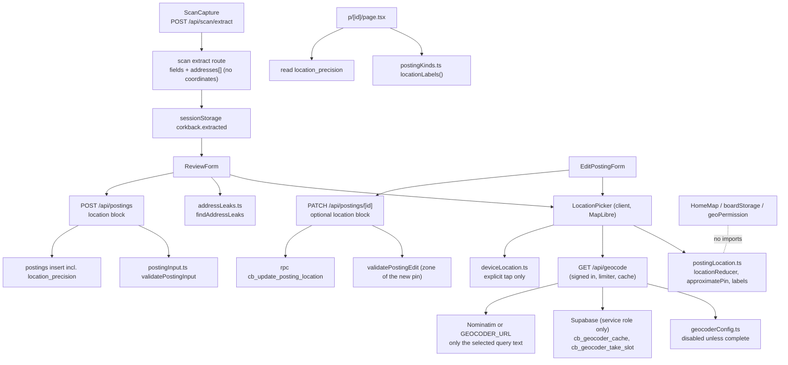
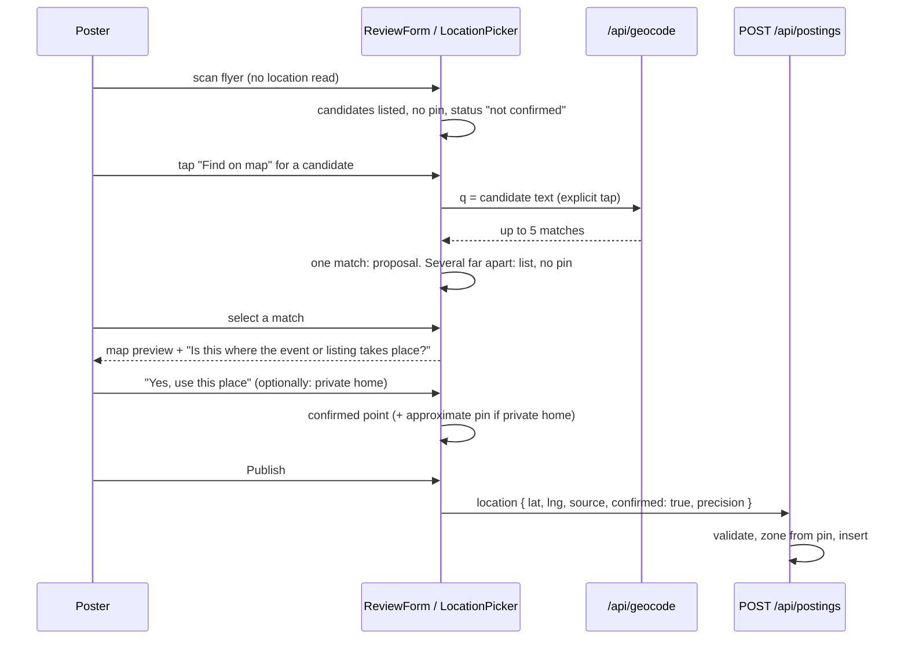
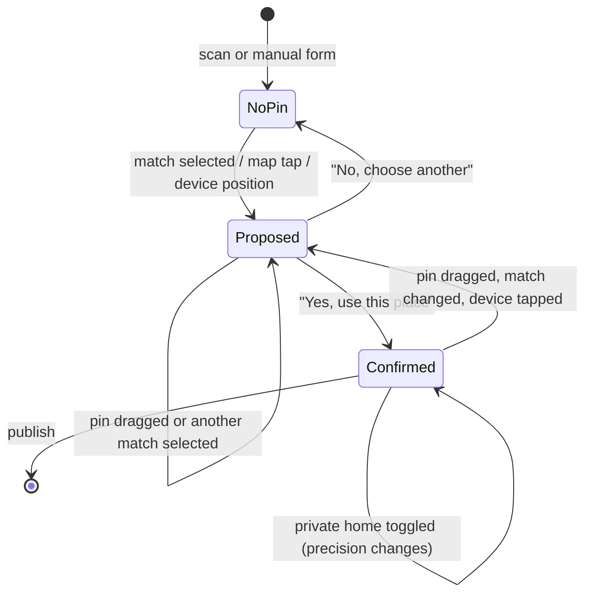

# Design Document: Posting Location Confirmation

## Overview

A posting's pin moves from "where the poster is" to "where the event or listing takes place". The poster gets there by confirming or choosing the place on a map before publishing. Four pieces change:

1. **Scan** also returns every address printed on the flyer as a list of candidates (text and a kind hint, no coordinates).
2. **Review** replaces the "Your current pin" block with a `LocationPicker`: candidates, place search, a draggable pin, an optional "Use my location" button, and a private-home checkbox. Nothing becomes the pin until the poster answers "Is this where the event or listing takes place?" with "Yes, use this place".
3. **Publish and edit** take a `location` block (confirmed point, source, precision) instead of `real` and `desired`. The 150 m clamp is retired. The server checks that the point is valid and that it was confirmed. An owner can later change the location of an existing posting through one new database function.
4. **Copy** on the scan, review, edit and detail pages stops saying the posting pins where the poster stands. The detail page shows a label that fits the category.

The design is TypeScript on Next.js 15 (App Router), React 19, Supabase and MapLibre 6.17. The logic that matters (draft state machine, approximate pin, candidate and match normalizing, address-leak detection, validators) lives in pure modules so vitest and fast-check can test it. No runtime or test dependency is added.

### Findings from reading the code

| Area | What the code does today | Consequence |
|---|---|---|
| Where the pin comes from | `ReviewForm.requestLocation()` calls `navigator.geolocation.getCurrentPosition` when the poster taps "Use my current location". The result is sent as `real: coords, desired: coords`. `validatePostingInput` requires `real` ("Your current location is required to pin the posting.") and sets `pin = clampPinNudge(real, desired)`, which keeps the pin within `MAX_NUDGE_METERS = 150` of the device. There is no way to place the pin by hand ("no manual drag in Stage 1"). | A flyer scanned at home pins the event at the scanner's house. Publishing is impossible without location permission. |
| Flyer extraction | `src/app/api/scan/extract/route.ts` asks Gemini for `title, eventDate, eventTime, placeLabel, categorySlug, rsvpUrl, body, eventDateYearPrinted`. The prompt says "Do not invent a location pin — placeLabel is only the text on the flyer." The route keeps one `placeLabel` string and returns no coordinates. | A flyer with several addresses (venue, organizer, return address) collapses to one string with no kind hint. |
| What is stored | `postings.lat`, `postings.lng` (double precision, full precision), `place_label` (free text), `time_zone`. The insert grant is the column list in `stage8_moderation.sql`. There is no precision or source column. `supabase/schema.sql` says the poster's raw device location is never stored: true, because the stored pin is the clamped point (within 150 m of the device). | The "raw location is never stored" promise holds only because the pin was always within 150 m of it. Under the new rule the pin is whatever the poster confirms, so privacy for a home needs its own mechanism. |
| What is public | RLS policy "postings public read" lets anyone read every column of a visible posting. `POSTING_COLUMNS` (`src/lib/postings.ts`) includes `lat, lng, place_label`. `/api/postings/map` returns them at full precision in `pins` and `cards` mode (pins responses are CDN-cached 30 s). The detail page, alert emails (`Place: …`), the friends page and the admin queue show `place_label`. The only rounding is the coarse card distance (`nearby.ts`). | A stored pin is public at full precision. An approximate pin must be stored as the approximate point. Nothing exact may reach the server. |
| Edit | `PATCH /api/postings/[id]` writes content columns only. `stage8_moderation.sql` grants UPDATE on `title, body, category_id, rsvp_url, event_date, event_time, end_date, end_time, place_label, is_promoted`. Pin and `time_zone` are not updatable. `EditPostingForm` says the pin "can't be changed" and tells the owner to delete and republish. | An existing pin at someone's home cannot be fixed without deleting the posting. Changing a pin needs SQL. |
| Time zone | `timeZoneForPin` runs at publish only. `time_zone` is stored. The lifecycle rule uses only the stored zone. Edit validation uses the stored zone. `stage13_takedown_app_parity*.sql` is a separate draft that is not applied. | Changing the pin on edit must recompute and store the zone, and must judge dates in the new zone. |
| Geocoding | `HomeMap.searchTown` calls `nominatim.openstreetmap.org/search?limit=1` straight from the browser. `api/alerts/route.ts` geocodes a town name on the server with a `User-Agent`. No shared helper, no route, no address details. The public Nominatim usage policy allows at most 1 request per second for the **whole application** (not per server instance), expects results to be cached, requires an identifying User-Agent or Referer and attribution, forbids autocomplete, asks apps to be switchable, and asks callers not to submit personal data. The board's map tiles already carry the plain text attribution "© OpenStreetMap contributors" in the MapLibre source (`MapView.tsx`, `HomeMap.tsx`), with no link. | Address lookup needs a server route with a **shared** throttle and cache (Supabase is the only shared store; a per-instance limiter on Vercel does not bound the whole app), a provider switch, a configured User-Agent, a linked attribution in the picker, and a lookup that runs only on an explicit tap and sends only the chosen address. The two direct Nominatim calls above stay outside this throttle (see "Residual risk"). |
| Flyer image | The scan photo goes to Gemini and is not stored. `flyer_url` is never written: it is not in the insert grant, and the only reader is the detail page's `` when non-null. | The image-address warning (Requirement 11.8) has no live case today. It is specified for the day a flyer image is published. |
| Home browsing location | `HomeMap` keeps the reference point, `localStorage["corkback.mapCenter"]` (`boardStorage.ts`), `geolocationAlreadyGranted()` (`geoPermission.ts`), and its own "Use my location" and town search. `AlertsManager` has a separate "use my location". | The posting flow must share none of this state. The new modules import none of it, and a guard test enforces that. |
| Categories | `postingKinds.ts`: `LISTING_SLUGS` = jobs, housing, sale, lost-found; `EVENT_OPTIONAL_SLUGS` = community; everything else is an event. | Location labels hang off `categoryKind` and the slug. |
| Tests that assert the old rule | `domain.test.ts` ("pin nudge rule", Property 3), `postingInput.test.ts` (`MAX_NUDGE_METERS`, "requires a poster location", "result never carries the raw location"), `postingInput.kinds/community/listing/postingEdit.test.ts` (publish bodies use `real`), `postingInputBaseline.ts` (frozen copy that calls `clampPinNudge`), `route.edit.test.ts` (`EDITABLE` columns, no pin), `scan/extract/route.test.ts` (`toEqual({ extracted: flyer })`). | All of these change. See "Retiring the clamp". |

### Key decisions

| Decision | Choice | Why |
|---|---|---|
| What becomes the pin | Only a point the poster confirms with "Yes, use this place". Candidates, matches, map taps and the device shortcut all create a **proposal**. | One rule, one place to test. Satisfies "never publish an extracted address as the pin without confirmation". |
| Where the approximate pin is computed | **In the browser**, before publishing. The server receives and stores only the approximate point. | The exact address never reaches CorkBack's server or database. The preview shows exactly what visitors get. No server-side secret to protect. |
| Approximation | Random distance 150 to 400 m, random direction, computed once per confirmed point and kept while other fields change. | The pin is never the true point, and re-saving does not produce new samples that could be averaged. |
| SQL | **Needed**: one column `location_precision` and one function `cb_update_posting_location`. | Public pages need to know a pin is approximate. Editing a pin needs a write path that does not widen column grants. See "SQL decision". |
| Geocoder | New signed-in route `GET /api/geocode` in front of Nominatim (endpoint from `GEOCODER_URL`). An application-wide throttle (`cb_geocoder_take_slot`, one slot per 1100 ms) and a shared 24 h cache (`cb_geocoder_cache`, HMAC keys) live in Supabase and are reachable by the service role only. A per-user cap stays as an extra, best-effort limit. Lookups run only on tap or submit and send only the chosen address. | Policy compliance on a multi-instance host, provider switch, no personal data beyond the address the poster chose. |
| Geocoder when a policy condition fails | **Public Nominatim is disabled**: the route answers 503 `unavailable`, makes no upstream call, and the poster places the pin by hand, uses "Use my location", and publishes. | A missing User-Agent, secret or shared store must never turn into unthrottled traffic. |
| Query with a phone number or email | **Refused**, not stripped (HTTP 422 `query_refused`, client and server). | Stripping could send a mangled but still personal remainder and hides what was sent. Refusing sends nothing and tells the poster why. |
| Personal-details warning | Warn and acknowledge only, for street addresses, phone numbers and email addresses. Never edits text. | Public venue and organizer details are legitimate and must stay. |
| Device location | One `getCurrentPosition` call in `deviceLocation.ts`, called only from the picker's button. | Smaller than the home board's multi-sample flow, and keeps the two flows apart. |
| Existing postings | Untouched by the migration. Their precision reads `unreviewed`. Changed only by an owner's save with a `location` block. | Requirement 13. |

## Architecture



### Publish data flow



### Draft state machine



`publishableLocation(draft)` returns a payload only in `Confirmed`. Candidate lists and match lists never change the state on their own.

## Components and Interfaces

### Pure modules (new, no server-only imports)

**`src/lib/addressCandidates.ts`**

```typescript
export type CandidateKind = "venue" | "contact" | "return" | "other" | "unknown";
export interface AddressCandidate { text: string; kind: CandidateKind }
export const MAX_CANDIDATES = 5;
export const MAX_CANDIDATE_TEXT = 200;

/** Never throws. Anything that is not a list of {text, kind?} becomes []. Caps, trims, dedupes by normalized text. */
export function normalizeAddressCandidates(raw: unknown): AddressCandidate[];
/** Lowercase, strip punctuation and extra spaces, expand common street suffixes (st→street). Used for dedupe and leak checks. */
export function normalizeAddressText(s: string): string;
/** Validated read of the sessionStorage value. Missing `addresses` becomes []. Returns null when unreadable. */
export function parseStoredExtraction(json: string | null): ExtractedFlyer | null;
export function serializeExtraction(e: ExtractedFlyer): string;
```

**`src/lib/geocode.ts`**

```typescript
export interface LatLng { lat: number; lng: number }
export type MatchLevel = "address" | "area";
export interface PlaceMatch {
  id: string;            // "{osm_type}{osm_id}"
  name: string;          // venue or place name, may be ""
  addressLine: string;   // "{house_number} {road}", may be ""
  area: string;          // neighbourhood, suburb, town or city, may be ""
  displayName: string;   // for the result list
  point: LatLng;
  level: MatchLevel;
}
export const AMBIGUOUS_METERS = 250;
/** Never throws. Drops rows with invalid coordinates, keeps at most 5, removes rows within 25 m of an earlier row with the same displayName. */
export function normalizeNominatim(rows: unknown): PlaceMatch[];
export function matchLevel(row: NominatimRow): MatchLevel;
/** True when two or more matches lie more than 250 m apart. Order does not matter. */
export function isAmbiguous(matches: readonly PlaceMatch[]): boolean;
```

Level rule: `address` when the row has `address.house_number`, or its `category` is one of `amenity, building, shop, tourism, leisure, office, historic, craft, healthcare, man_made`. Everything else (roads, suburbs, towns, boundaries) is `area`.

**`src/lib/postingLocation.ts`**

```typescript
export type PinSource = "flyer_candidate" | "search" | "pin" | "device";
export type Precision = "exact" | "approximate";
export const APPROX_MIN_METERS = 150;
export const APPROX_MAX_METERS = 400;
export const STALE_LABEL_METERS = 100;

export interface LocationDraft {
  candidates: AddressCandidate[];
  matches: PlaceMatch[];
  proposal: { point: LatLng; source: PinSource; match: PlaceMatch | null } | null;
  confirmed: { point: LatLng; source: PinSource; match: PlaceMatch | null } | null;
  privateHome: boolean;
  /** Approximate point for the confirmed point; set only while privateHome is true. */
  approx: LatLng | null;
  label: { text: string; origin: "none" | "derived" | "typed"; derivedFrom: LatLng | null };
  /** Existing posting only: what is stored now. Never sent unless the owner confirms a new location. */
  existing: { point: LatLng; precision: "exact" | "approximate" | "unreviewed"; label: string } | null;
  notice: LocationNotice | null; // a code, rendered as copy by the picker
}
export type LocationNotice = "label_cleared" | "label_kept" | "device_failed" | "no_match" | "area_match"
  | "search_unavailable" | "search_busy" | "query_refused" | "location_save_failed";

export type LocationEvent =
  | { type: "extracted"; candidates: AddressCandidate[] }
  | { type: "matches_loaded"; matches: PlaceMatch[]; autoPropose: boolean }
  | { type: "match_selected"; match: PlaceMatch; source: "flyer_candidate" | "search" }
  | { type: "pin_placed"; point: LatLng }
  | { type: "device_succeeded"; point: LatLng }
  | { type: "device_failed" }
  | { type: "search_failed"; kind: "unavailable" | "busy" | "refused" }
  | { type: "location_save_failed" }
  | { type: "proposal_confirmed"; rand: [number, number] }
  | { type: "proposal_rejected" }
  | { type: "private_home_set"; value: boolean; rand: [number, number] }
  | { type: "label_typed"; text: string }
  | { type: "existing_loaded"; point: LatLng; precision: "exact" | "approximate" | "unreviewed"; label: string };

export function emptyDraft(): LocationDraft;
export function locationReducer(d: LocationDraft, e: LocationEvent): LocationDraft;

/** The payload for the server, or null unless the draft is confirmed. The point is the approximate point when privateHome is true. */
export function publishableLocation(d: LocationDraft): LocationPayload | null;
export interface LocationPayload { lat: number; lng: number; source: PinSource; confirmed: true; precision: Precision }
/** The point shown to visitors for the current draft (approximate point or confirmed point), or null. */
export function publicPin(d: LocationDraft): LatLng | null;

/** distance in [150, 400] m, bearing in [0, 2π). Both come from `rand` in [0, 1). */
export function approximatePin(exact: LatLng, rand: [number, number]): LatLng;
export function circleRing(center: LatLng, meters: number, steps?: number): LatLng[];
/** Move a point 10 m north, south, east or west (the keyboard alternative to dragging). */
export function nudgePin(point: LatLng, dir: "n" | "s" | "e" | "w", meters?: number): LatLng;
/** The note for the detail page: "Approximate location. The exact address is not shown." for approximate, null otherwise. */
export function locationNote(precision: "exact" | "approximate" | "unreviewed"): string | null;
export const DEFAULT_VIEW: { center: [number, number]; zoom: number }; // fixed, not location-based
```

Reducer rules:

- `matches_loaded`: replaces `matches`. When `autoPropose` and the set is not ambiguous and non-empty, sets `proposal` to the first match (source from the caller, kept in `match_selected`). When ambiguous or empty, `proposal` stays `null`. A match with level `area` sets `notice = "area_match"`. An empty set sets `notice = "no_match"`.
- `match_selected`: sets `proposal`, clears `confirmed` and `approx`. If `label.origin` is `derived`, the label becomes the derived text of the new match. If `typed`, the label stays and `notice = "label_kept"`.
- `pin_placed` and `device_succeeded`: set `proposal` to the point (`match: null`), clear `confirmed` and `approx`. A derived label whose `derivedFrom` is more than 100 m from the point is cleared (`origin: "none"`, `notice: "label_cleared"`).
- `proposal_confirmed`: requires a `proposal`. Moves it to `confirmed`. When `privateHome` is true, sets `approx = approximatePin(point, rand)` and the label becomes `Near {area}` if it was derived. Without a proposal the event is ignored.
- `proposal_rejected`: clears `proposal`.
- `private_home_set`: with a `confirmed` point, computes or clears `approx` and swaps a derived label between the street text and `Near {area}`. Without a confirmed point, only stores the flag, and `proposal_confirmed` applies it.
- `device_failed`, `search_failed` and `location_save_failed`: set `notice` (`device_failed`, `search_unavailable` / `search_busy` / `query_refused`, `location_save_failed`) and change nothing else. In particular `confirmed`, `approx`, `privateHome` and the label stay, so a failed search never blocks a manual pin and a failed location save keeps the poster's chosen pin for the Retry.
- `extracted`, `matches_loaded` and `existing_loaded` never set `confirmed`.

`approx` is recomputed only in `proposal_confirmed` and in `private_home_set`. Editing the label, the title or any other field leaves it alone.

**`src/lib/addressLeaks.ts`**

```typescript
export interface LeakInput { title: string; body: string; placeLabel: string }
export interface AddressLeak {
  field: "title" | "body" | "placeLabel";
  text: string;
  reason: "candidate" | "pattern" | "phone" | "email";
}
/**
 * Personal details in the posting. It reads its input and never changes it.
 * Phone numbers and email addresses (from `findContactDetails`) are always reported, in any field.
 * Address text that is not the confirmed public place:
 * - A candidate leaks when its normalized text occurs in a field, unless it is the confirmed match's street
 *   line and precision is exact.
 * - A street-address pattern leaks when it matches no candidate, unless it is the confirmed street line with exact precision.
 * - With approximate precision the confirmed street line is itself a leak.
 */
export function findAddressLeaks(input: LeakInput, candidates: readonly AddressCandidate[],
  confirmed: { addressLine: string } | null, precision: Precision): AddressLeak[];
```

```typescript
/** Publishing is allowed when there are no leaks, or when the poster ticked the acknowledgement. */
export function canPublishWithLeaks(leaks: readonly AddressLeak[], acknowledged: boolean): boolean;
/** For a future published flyer image: the candidates of kind contact, return or unknown, as one list. */
export function imageAddressWarning(candidates: readonly AddressCandidate[]): string | null;
```

The pattern is a house number followed by one to four words and a street suffix (`street, st, avenue, ave, road, rd, boulevard, blvd, drive, dr, lane, ln, court, ct, way, place, pl, terrace, parkway, highway`), case-insensitive.

**`src/lib/contactDetails.ts`** (pure, shared by the leak check and the geocoder query check)

```typescript
export interface ContactMatch { kind: "phone" | "email"; text: string; index: number }
/** Never throws. Reports phone numbers and email addresses; reads its input only. */
export function findContactDetails(text: string): ContactMatch[];
export function hasContactDetails(text: string): boolean;
```

Email: `[A-Za-z0-9._%+-]+@[A-Za-z0-9-]+(\.[A-Za-z0-9-]+)*\.[A-Za-z]{2,}`.

Phone, applied with `(?<!\d)` and `(?!\d)` boundaries so a longer digit run never yields a partial match:

- Separated 10-digit forms: `(\+?\d{1,3}[\s.-]?)?(\(\d{3}\)|\d{3})[\s.-]?\d{3}[\s.-]?\d{4}`.
- International: `\+\d{1,3}([\s.-]?\d{1,4}){2,5}` with 9 to 15 digits in total.
- Local seven-digit form, only with a hyphen or dot: `\d{3}[.-]\d{4}`, and not when the character before the match is a digit or a hyphen or dot that follows a digit (so `94704-1234` is never read as `704-1234`).

A candidate match is then dropped when it also parses as a date (`YYYY-MM-DD`, `MM/DD/YYYY`, `DD.MM.YYYY`), a time (`h:mm`), a price (a leading `$` or `€`, or a comma-thousands group), a year, or a five-digit postcode with an optional four-digit extension. A bare run of 10 digits without any separator is reported only when it starts with a digit from 2 to 9. Documented limit: the detector favors warning over silence for separated 10-digit numbers, and it can miss numbers written with words or unusual separators. The warning is advisory, so a miss costs a missed warning and a false positive costs one checkbox.

**`src/lib/deviceLocation.ts`**

```typescript
export type DeviceResult =
  | { ok: true; point: LatLng }
  | { ok: false; reason: "unsupported" | "denied" | "unavailable" | "timeout" };
/** One getCurrentPosition call (timeout 10 s, maximumAge 0). Called only from the picker's "Use my location" handler. */
export function requestDeviceLocation(nav?: Navigator): Promise<DeviceResult>;
```

**`src/lib/geocodeQuery.ts`** (pure, used by the picker and the route)

```typescript
export const MAX_QUERY_CHARS = 200;
export const MIN_QUERY_CHARS = 3;
export type PreparedQuery =
  | { ok: true; query: string }
  | { ok: false; reason: "too_short" | "contains_contact" };
/** trim, collapse whitespace runs to one space, cut to 200 chars; then refuse when findContactDetails reports anything. */
export function prepareGeocodeQuery(raw: string): PreparedQuery;
/** The upstream URL. The only free text is `q`. Other params are fixed (format=jsonv2, addressdetails=1, limit=5, dedupe=1) plus the optional provider key. */
export function buildGeocodeUrl(base: string, query: string, key?: { param: string; value: string }): string;
/** Normalization used for the cache key only: NFC, lowercase, whitespace collapsed. */
export function normalizeForCache(query: string): string;
/** hex HMAC-SHA256 over `${providerHost}\n${normalizeForCache(query)}` with the server secret. Never contains the query. */
export function cacheKey(query: string, providerHost: string, secret: string): string;
```

`prepareGeocodeQuery` is the one function that produces the text that leaves the app. The picker calls it before `fetch`, and the route calls it again on the received `q`. The route takes nothing else from the request into the upstream call: no cookies, no user id, no other query parameters.

**`src/lib/geocoderConfig.ts`** (pure, takes an env object)

```typescript
export type GeocoderConfig =
  | { enabled: true; endpoint: string; host: string; publicNominatim: boolean; userAgent: string;
      referer: string | null; apiKey: { param: string; value: string } | null; cacheSecret: string }
  | { enabled: false; reason: "no_supabase" | "bad_endpoint" | "bad_user_agent" | "no_cache_secret" };
export function resolveGeocoderConfig(env: Record<string, string | undefined>): GeocoderConfig;
export function isValidUserAgent(ua: string | undefined): boolean;
```

Rules: `NEXT_PUBLIC_SUPABASE_URL` and `SUPABASE_SERVICE_ROLE_KEY` set; `GEOCODER_URL` (default `https://nominatim.openstreetmap.org/search`) parses as an `https:` URL; `GEOCODER_USER_AGENT` matches `^[A-Za-z][\w.-]*/\d[\w.-]* \(.*(\S+@\S+\.\S+|https:\/\/\S+).*\)$` (name, version, contact), for example `CorkBack/1.0 (place search; contact: owner@example.com)`; `GEOCODER_CACHE_SECRET` is at least 32 characters. `referer` is `GEOCODER_REFERER`, else `NEXT_PUBLIC_APP_URL`, else `null`. `apiKey` is set only when `GEOCODER_API_KEY` is set and the host is not `nominatim.openstreetmap.org`. The result never throws and never includes the secret in an error value.

**`src/lib/geocodeUserCap.ts`** (server, pure with an injected clock; replaces the earlier `geocodeLimiter.ts` with its token gate and TTL cache, which a multi-instance host cannot use)

```typescript
export function createUserCap(opts: { max: number; windowMs: number; now: () => number }): { take(userId: string): boolean };
```

The cap is per server instance and therefore best effort. It limits one signed-in user's repeated taps. It is **not** the policy control. The policy control is the shared throttle below.

**`src/lib/geocoderStore.ts`** (server only; the only file that calls the shared throttle and cache)

```typescript
export interface GeocoderStore {
  /** wait in ms (0 to maxWaitMs), or null when the next slot is further away than maxWaitMs. Throws on a database error. */
  takeSlot(maxWaitMs: number): Promise<number | null>;
  /** Unexpired cached matches for the key, or null. Throws on a database error. */
  cacheGet(key: string): Promise<PlaceMatch[] | null>;
  /** Writes with a 24 h expiry, then calls the purge. Errors are returned to the caller, not thrown. */
  cachePut(key: string, matches: PlaceMatch[]): Promise<{ ok: boolean; code?: string }>;
  purgeExpired(): Promise<number>;
}
export function createGeocoderStore(client: SupabaseClient /* service role */): GeocoderStore;
```

**`postingKinds.ts` addition**

```typescript
export interface LocationLabels { field: string; detail: string; hint: string }
export function locationLabels(slug: string, opts: { hasEventDate: boolean }): LocationLabels;
```

| Category | Condition | `field` | `detail` |
|---|---|---|---|
| Event categories (music, nightlife, sports, social-clubs, classes) | any | Event venue | Event venue |
| Community | has event date | Event venue | Event venue |
| Community | no event date | Location | Location |
| jobs, housing, sale | any | Listing location | Listing location |
| lost-found | any | Where it was lost or found | Lost or found near |

`hint` is "This text is shown to visitors. The pin shows the same place on the map." for every row.

### Server and routes

**`GET /api/geocode?q=…`** (`src/app/api/geocode/route.ts`)

Every response body is `{ state, error?, matches? }`. States: `ok`, `unavailable`, `busy`, `user_limit`, `query_refused`, `bad_query`, `signed_out`.

1. **Auth.** 401 `{ state: "signed_out", error: "Sign in to search for a place." }` when signed out. No other work.
2. **Config.** `resolveGeocoderConfig(process.env)`. When `enabled` is `false` (no Supabase or service role key, bad endpoint, invalid User-Agent, missing or short cache secret), answer 503 `{ state: "unavailable", error: "Place search is unavailable right now." }`. **No store call and no upstream call.** This covers demo mode, which has no Supabase.
3. **Query.** `prepareGeocodeQuery(q)`. `too_short` gives 400 `bad_query`. `contains_contact` gives 422 `{ state: "query_refused", error: "That search includes a phone number or email address, so it was not sent. Search with just the street address or the place name." }`. No store call and no upstream call.
4. **User cap.** 429 `user_limit` ("Too many searches. Try again in a few minutes.") when the per-instance cap (20 per 10 minutes) is exceeded.
5. **Cache read.** `key = cacheKey(query, config.host, config.cacheSecret)`; `store.cacheGet(key)`. A hit returns 200 `ok` and takes no slot and makes no upstream call. A thrown error means the shared cache cannot be trusted, so the route answers 503 `unavailable` and makes no upstream call.
6. **Throttle.** `store.takeSlot(3000)`. `null` gives 429 `{ state: "busy", error: "Place search is busy. Try again in a moment." }` with `Retry-After: 2`. A thrown error (function missing because stage14 is not applied, database down) gives 503 `unavailable`. Neither makes an upstream call. A number is the wait in ms (0 to 3000): the route sleeps that long, measured by the database, so server clock skew does not matter.
7. **Upstream.** One `fetch` of `buildGeocodeUrl(config.endpoint, query, config.apiKey)` with headers `User-Agent: config.userAgent`, `Accept-Language: en`, and `Referer: config.referer` when set, an 8 s abort, no cookies and no other headers. A timeout, network error or non-200 gives 502 `unavailable`.
8. **Normalize and store.** `normalizeNominatim(rows)`; `store.cachePut(key, matches)`. A failed write is logged by code only and does not change the answer. Empty results are cached too, so a repeated miss makes no second upstream call.
9. 200 `{ state: "ok", matches }`.

The route logs only the state and the HTTP status. It never logs `q`, the prepared query, the cache key or the response body. The shared throttle bounds upstream requests at one per 1100 ms **across all instances**, whatever the per-instance caps do. The cache reduces repeats. If traffic outgrows this, `GEOCODER_URL` (and `GEOCODER_API_KEY`) point the route at a keyed provider with no code change. The throttle interval stays 1100 ms for every provider in this stage, which is the conservative choice.

**Hourly sweep.** `src/app/api/cron/expire/route.ts` also calls `store.purgeExpired()` after its existing work and reports the count. A failure there is logged by code and does not fail the sweep. Purging also runs after each cache write, so expired rows do not outlive their 24 h TTL for long even without traffic.

#### Environment variables

| Variable | Required | Purpose |
|---|---|---|
| `GEOCODER_URL` | no, default `https://nominatim.openstreetmap.org/search` | Provider endpoint. Must be `https`. |
| `GEOCODER_USER_AGENT` | **yes for any provider** | Identifying User-Agent with a contact, for example `CorkBack/1.0 (place search; contact: owner@example.com)`. Missing or invalid disables search. |
| `GEOCODER_REFERER` | no | Referer header. Falls back to `NEXT_PUBLIC_APP_URL`. |
| `GEOCODER_API_KEY`, `GEOCODER_API_KEY_PARAM` | only for a keyed provider | The key and the query parameter name (default `key`). |
| `GEOCODER_CACHE_SECRET` | **yes** | Server secret, at least 32 random characters, for the cache HMAC. Never logged, never sent to the browser. |
| `NEXT_PUBLIC_SUPABASE_URL`, `SUPABASE_SERVICE_ROLE_KEY` | yes (already used elsewhere) | The shared throttle and cache are reachable only with the service role. |

All are added to `.env.example` with comments and empty values. None is set in this work. The Owner sets them in Vercel before the code release.

#### Residual risk

`HomeMap.searchTown` (browser) and `api/alerts/route.ts` (server) call `nominatim.openstreetmap.org` directly. Both are one-lookup-per-tap, user-initiated, and out of scope here (Requirement 4.13), but they are **not** counted by the shared throttle, so the application-wide limit is guaranteed only for the picker route. A follow-up should route them through the same store. The board map tiles show the attribution without a link. The picker links it, and the board maps are not changed in this work.

**`POST /api/scan/extract`** (changed). Prompt additions: `addresses` (a list of every address or place name printed on the flyer, each `{"text": string, "kind": "venue"|"contact"|"return"|"other"|"unknown"}`, empty list when none; use `return` for a return address and `contact` for an organizer or host address; copy the text exactly as printed). The response keeps the existing keys and adds `addresses: normalizeAddressCandidates(parsed.addresses)`. The line "Do not invent a location pin" stays. `parsePlainLines` returns no addresses.

**`POST /api/postings`** (changed). Body: the existing fields, minus `real` and `desired`, plus

```json
{ "location": { "lat": 37.87, "lng": -122.27, "source": "search", "confirmed": true, "precision": "exact" } }
```

`validatePostingInput` returns `pin = { lat, lng }` (the submitted values), `precision`, and `timeZone = timeZoneForPin(pin)`. The route inserts `location_precision: p.precision`. It never stores `source`.

**`PATCH /api/postings/[id]`** (changed). An optional `location` block of the same shape. `validatePostingEdit` returns `location: { pin, precision, timeZone } | null`, and runs its date checks in `location.timeZone` when present, otherwise `ctx.timeZone`. The route applies the content update first, then calls `cb_update_posting_location` when `location` is present. `cb_safe_time_zone` is applied inside the function.

**`PATCH /api/postings/[id]/location`** (new, the Retry path). Body `{ "location": LocationBlock }` and nothing else. The route validates the block with the same `validateLocationBlock` helper that `validatePostingInput` and `validatePostingEdit` use (extracted into `postingInput.ts`), checks the signed-in user, and calls `cb_update_posting_location` once. It writes no content column. The earlier combined request already judged the event dates in the zone of the new pin before saving any content, so the retry does not re-run the date checks. The function itself refuses an ended or hidden posting (`CB409`, `CB404`). Error mapping is the same as the combined request: `CB404` and `CB409` give 409 `unavailable`, `22023` gives 400 `invalid`, anything else gives 500 `location_failed` with "Your other changes were saved, but the location was not."

### UI components

**`src/components/map/LocationPicker.tsx`** (client). Props: `categorySlug`, `hasEventDate`, `candidates`, `initial?: { point, precision, label }` (edit), `draft` and `dispatch` from the parent's `useReducer`, `onLabelChange`. It owns the MapLibre map (one instance per mount, as `MapView` does), the pin marker (dark red, draggable), the approximate-area circle (GeoJSON layer from `circleRing`, navy outline), the search form, the candidate list, the match list, the confirmation bar and the private-home checkbox. It calls `fetch("/api/geocode")` only from the "Find on map" handler and the search-form submit handler, after `prepareGeocodeQuery` accepts the text. There is no `onChange` request, no debounce lookup and no suggestion list. A second lookup cannot start while one is in flight (the buttons are disabled). A refused, busy or unavailable answer dispatches `search_failed` and shows its message while the map, the nudge buttons, "Use my location" and the Place_Label field keep working. Attribution is a link, `<a href="https://www.openstreetmap.org/copyright">© OpenStreetMap contributors</a>`, set as the `attribution` of the picker's tile source (MapLibre renders the string as HTML in its attribution control) and repeated as text under the result list. Map style: a copy of the board's tan style in `src/components/map/pickerMapStyle.ts` (the board files are not edited, so the board's code path stays untouched).

Layout, top to bottom (390 px wide): heading "Where does this take place?" with the category's `field` label; candidate list (if any); search form ("Search for a place or address", "Search" button); map (h-72); confirmation bar when a proposal exists; "Use my location" with its hint; private-home checkbox with the explanation; Place_Label field with the category hint.

Buttons: "Yes, use this place" is navy (secondary). "No, choose another", "Find on map", "Search", "Use my location" and the nudge buttons are neutral or navy outline. The one dark-red main action on the review screen stays "Publish to the map".

Pin controls without dragging: four buttons "Move pin north / south / east / west" that move the proposal by 10 m per tap (`pin_placed` event). They appear only when a proposal exists.

**`ReviewForm.tsx`** (changed): holds `useReducer(locationReducer, emptyDraft())`; on load runs `parseStoredExtraction`, dispatches `extracted`; computes `leaks = findAddressLeaks(...)` on every render from state; shows the warning block and the acknowledgement checkbox when `leaks.length > 0` (street addresses, phone numbers and email addresses; the warning names the field and the kind, says the poster can keep public venue or organizer contact details, and never edits the fields); publish sends `location: publishableLocation(draft)` and refuses to send when it is `null` or when leaks exist and the box is unchecked. The takedown preview uses `timeZoneForPin` of `publicPin(draft)`.

**`EditPostingForm.tsx`** (changed): shows a read-only map of the current pin (`initial`), the legacy notice for `unreviewed`, a "Change location" button that mounts the picker, and sends `location` only when `publishableLocation(draft)` is non-null. For an existing `approximate` posting the private-home box is checked and disabled with "This posting already uses an approximate pin. To change it, choose the place again." Choosing a place again starts from `exact`. The takedown line uses the zone of the new pin when there is one.

**`p/[id]/page.tsx`** (changed): the place row shows `locationLabels(...).detail` in front of the Place_Label, and one extra line for `approximate`. The precision comes from a new `getLocationPrecision(supabase, id)` read, kept out of `POSTING_COLUMNS` so the shared map query and every other reader are untouched. If that read fails (column not yet present), it logs the error code and returns `unreviewed`, so the page still renders.

## Data Models

### Request and response shapes

```typescript
interface LocationBlock { lat: number; lng: number; source: PinSource; confirmed: true; precision: Precision }

interface ExtractedFlyer {            // src/lib/types.ts, one field added
  /* existing fields */
  addresses?: AddressCandidate[];     // absent in extractions saved before this change
}

interface Posting {                   // src/lib/types.ts, one optional field added
  /* existing fields */
  locationPrecision?: "exact" | "approximate" | "unreviewed";
}
```

### Database

Stage 14 adds one column, one grant change and five functions or tables (see "SQL decision"). Final object list:

| Object | Definition |
|---|---|
| `postings.location_precision` | `text not null default 'unreviewed' check (location_precision in ('exact','approximate','unreviewed'))` |
| insert grant | the stage 8 column list plus `location_precision` |
| `public.cb_update_posting_location(p_posting_id uuid, p_lat double precision, p_lng double precision, p_time_zone text, p_precision text) returns text` | `security definer`, `set search_path = ''`, author-only, active and visible posting only, finite coordinates in range, precision in `exact` or `approximate`, zone kept only if `cb_safe_time_zone` accepts it, updates `lat, lng, time_zone, location_precision`, returns `'updated'` |

Error codes from the function: `42501` (not signed in), `CB404` (no such posting, not the author, deleted or hidden), `CB409` (posting no longer active), `22023` (bad coordinates or precision). The function validates first and then runs **one** `update … where id = p_posting_id` statement, so a failure leaves the previous `lat`, `lng`, `time_zone` and `location_precision` untouched. There is no partial state to repair.

| Geocoder object | Definition |
|---|---|
| `public.cb_geocoder_throttle` | One row: `id boolean primary key default true check (id)`, `next_slot_at timestamptz not null default '-infinity'`. RLS on, no policies. |
| `public.cb_geocoder_take_slot(p_max_wait_ms integer default 3000) returns table (slot_at timestamptz, wait_ms integer)` | `security definer`, `set search_path = ''`. One statement: `update public.cb_geocoder_throttle set next_slot_at = greatest(next_slot_at, clock_timestamp()) + interval '1100 milliseconds' where id and greatest(next_slot_at, clock_timestamp()) <= clock_timestamp() + least(greatest(p_max_wait_ms, 0), 5000) * interval '1 millisecond' returning …`. The row lock serializes concurrent callers, and a loser re-evaluates the `where` against the new `next_slot_at`. Returns the reserved `slot_at` (the new `next_slot_at` minus 1100 ms, which equals `greatest(old next_slot_at, now)`) and `wait_ms = greatest(0, ceil(extract(epoch from slot_at - clock_timestamp()) * 1000))`. Returns no row when the wait would exceed the bound. Execute granted to `service_role` only. |
| `public.cb_geocoder_cache` | `key_hash text primary key check (key_hash ~ '^[0-9a-f]{64}$')`, `results jsonb not null check (jsonb_typeof(results) = 'array' and octet_length(results::text) <= 20000)`, `created_at timestamptz not null default now()`, `expires_at timestamptz not null check (expires_at > created_at and expires_at <= created_at + interval '24 hours')`, index on `expires_at`. **No user id column.** RLS on, no policies. |
| `public.cb_geocoder_purge_cache() returns integer` | `security definer`, `set search_path = ''`; deletes rows with `expires_at <= now()` and returns the count. Execute granted to `service_role` only. |

Privileges for the three geocoder objects: `alter table … enable row level security` with **no policy**, `revoke all on … from public, anon, authenticated` (Supabase's default privileges grant `anon` and `authenticated` on new tables, so the revoke is explicit), `grant select, insert, update, delete on … to service_role`, `revoke execute on function … from public, anon, authenticated`, `grant execute on function … to service_role`. `service_role` bypasses RLS, so the no-policy RLS state blocks everyone else even if a grant is added by mistake.

**TTL: 24 hours**, enforced by the table check as well as by the route. Expired rows are ignored on read, purged after each write and by the hourly sweep.

No other column changes. `lat` and `lng` still hold the public pin. For an approximate posting they hold the approximate point and nothing exact exists anywhere.

## Privacy model

| Point | Where it exists | Who can see it |
|---|---|---|
| Device position (Use my location) | The poster's browser memory until the poster confirms it as a pin. Never saved to `localStorage`. | The poster. |
| Candidate address text | `sessionStorage["corkback.extracted"]` in the poster's browser. Sent to the geocoder only on an explicit tap. | The poster. The geocoder sees a tapped query without the poster's name. |
| Exact confirmed point (private home) | Browser memory only. | The poster. |
| Public pin | `postings.lat` and `postings.lng` (exact point when precision is `exact`, approximate point when `approximate`). | Everyone. |
| Place label | `postings.place_label`. | Everyone, in the posting, alert emails, the friends page and the admin queue. |

Consequences: the steering sentence "the user's exact location is never shown publicly" stays true for a private home and for any device position the poster does not confirm. If the poster confirms a device position as an exact pin, they chose to publish that point, and the review page says so (Requirement 7.4).

The geocoder receives the text of an address the poster tapped. This can be a home address. The route therefore sends no user id and no other identifying field to the provider, keeps no query log, and is switchable by `GEOCODER_URL`. The picker shows the note "Searching sends only this address text to a public map search service." under the search form and the candidate list.

What leaves the app on a lookup: only the prepared query string (`prepareGeocodeQuery`), a fixed set of format parameters, the User-Agent and the Referer. A query that contains a phone number or an email address is refused on the client and on the server, so nothing personal beyond the address the poster chose is sent. The flyer text, title, details, other candidates, user id, email and cookies never go upstream. In the shared store the query is kept only as an HMAC (`cb_geocoder_cache.key_hash`) with a result list that expires within 24 hours and carries no user id. The results themselves can describe a home address, which is why the table is reachable by the service role only and expired rows are purged.

### Approximate pin

```text
d  = 150 + (400 − 150) × rand[0]          // meters
θ  = 2π × rand[1]                          // radians
approx = destinationPoint(exact, d, θ)     // geodesic, as domain.ts does today
```

`destinationPoint` moves from a private helper in `domain.ts` to an export, and `haversineMeters` stays exported. The default `rand` comes from `crypto.getRandomValues`. The preview circle is centered on the approximate pin with a 400 m radius, so the circle always contains the true point and the poster sees what visitors can infer. The explanation text says "about a quarter mile (400 m)".

### Retiring the clamp

- `domain.ts`: delete `MAX_NUDGE_METERS`, `clampPinNudge` and the private `bearingRad`. Export `destinationPoint`. Update the file comment that calls the nudge LOCKED.
- `postingInput.ts`: remove the import and both calls; read `location` instead of `real` and `desired`.
- `domain.test.ts`: remove the "pin nudge rule" block (Property 3). Add the approximate-pin properties to a new `postingLocation.test.ts`.
- `postingInput.test.ts`: replace the clamp test and the `real`-based helpers with `location`-based ones.
- `postingInput.kinds/community/listing/postingEdit.test.ts`: change `real` to `location`.
- **`postingInputBaseline.ts` stays as it is.** It is the frozen regression oracle for the event-category rules (Property 12 of the board spec) and is a self-contained copy that imports `clampPinNudge` from `domain.ts`. Deleting the export would break the import. So the baseline gets its own copy of the old clamp inside `src/lib/__testing__/legacyClamp.ts` (test-only, copied unchanged from `domain.ts` before deletion), and its import line changes to that file. The comparison test in `postingInput.listing.test.ts` feeds both validators the same body: the new body carries `location`, and a small adapter in that test maps `location` to `real` and `desired` for the baseline call, so the property still compares event-category date, time and expiry rules and ignores the pin rule. The `fixtureGuard.test.ts` rule that only tests import `__testing__` code gets one extra case for `legacyClamp.ts`.

### SQL decision

SQL is needed. The pin could be stored without any new column (an approximate pin is just a point), but three things cannot be done without SQL:

1. **Editing the pin of an existing posting.** Clients have no UPDATE grant on `lat`, `lng` or `time_zone`, by design (stage 8). Without a change, an owner whose old posting sits at their house can only delete it. Granting column UPDATE would let a client write any point or any zone name straight through PostgREST, past all app validation. A `security definer` function with the author check, the activity check and the zone check keeps writes narrow.
2. **Telling visitors that a pin is approximate.** The label text cannot carry this reliably, since the owner can type over it. A stored value `location_precision` also lets the edit page treat an old posting as unreviewed.

3. **An application-wide geocoder throttle and a shared cache.** Vercel runs many instances and Supabase is the only shared store. A per-instance limiter cannot keep the whole application under 1 request per second. The throttle must be one atomic row update, and the cache must be a table that no client role can read, because a cached query can be a home address.

Everything else needs no SQL: the confirmation flow, candidates, labels, warnings and the publish payload.

The SQL is a draft, applied by the Owner, in this order, **before** the code release (old code ignores the new column and never calls the function, so applying it first is safe; new code reads and writes the column, so applying it after the code would break publishing):

| File | Purpose |
|---|---|
| `supabase/stage14_posting_location_preflight.sql` | Read-only. Expects the column, `cb_update_posting_location`, the two geocoder tables and the two geocoder functions absent. Prints the row count and an `md5` of `id, lat, lng, place_label, time_zone` over all rows, ordered by id. |
| `supabase/stage14_posting_location.sql` | One transaction: add the column, re-grant insert columns including it, create `cb_update_posting_location`, create the throttle and cache tables with RLS and revokes, create `cb_geocoder_take_slot` and `cb_geocoder_purge_cache`, grant execute as described. Assertions inside; any failure rolls everything back. |
| `supabase/stage14_posting_location_verify.sql` | In the style of `stage11_message_reads_verify_roles.sql`: one transaction with a `pg_temp.run_as(uid, role, sql)` helper that sets the JWT claims and `set local role`, disposable fixture users and postings (refuses to start if they exist), one result row per check, an overall first row, **a final row `ALL CHECKS PASS`**, and **`ROLLBACK`** so nothing is left. Checks: the same `md5` as the preflight (no existing row changed) and every existing row reads `unreviewed`; the author can change the location; another user gets `CB404`; an ended posting gets `CB409`; NaN, infinity and out-of-range values get `22023`; precision `unreviewed` is refused; a failed call leaves the row's `md5` unchanged (atomic, no partial update); `anon` cannot execute `cb_update_posting_location`; a direct `update … set lat` by `authenticated` fails with `42501`. Geocoder objects: `anon` and `authenticated` get `42501` on `select`, `insert`, `update`, `delete` of both tables and on `execute` of both functions; `service_role` can read and write both; `relrowsecurity` is true and `pg_policies` has no row for them; `cb_geocoder_cache` has no column named like `user` or `uid`; an `expires_at` more than 24 hours after `created_at` is rejected; a malformed `key_hash` is rejected; `cb_geocoder_take_slot` returns slots at least 1000 ms apart for sequential calls, returns no row when the bound is exceeded, and never moves `next_slot_at` backwards; `cb_geocoder_purge_cache` deletes only expired rows. |
| `supabase/stage14_posting_location_rollback.sql` | Drops the geocoder functions and tables and `cb_update_posting_location`, restores the stage 8 insert grant list, drops the column. Run it only after the code is rolled back. |

Adding a column with a constant default does not rewrite or change existing rows in Postgres 11 and later, and the verify file proves the `md5` is unchanged. The local run uses `supabase/isolated-test` (embedded PostgreSQL and PostgREST), never production. `stage13_takedown_app_parity*.sql` stays a separate, unapplied draft and this feature does not depend on it. The function calls the existing `cb_safe_time_zone`, so it follows whichever version is installed.

### Edit behavior for existing postings

- Opening `/p/[id]/edit` reads the stored pin and shows it on a read-only map. Nothing is written.
- A posting with precision `unreviewed` shows the notice "This pin was set from where the posting was published. Check that it marks where this takes place." A posting with precision `exact` shows "The pin marks where this takes place." An `approximate` posting shows the approximate-location note.
- "Change location" opens the picker with `existing_loaded`. The existing pin is not a proposal and not confirmed. Closing the picker without confirming sends no `location`.
- Saving without a `location` block leaves `lat`, `lng`, `time_zone` and `location_precision` as stored. A route test asserts the update payload has none of those keys.
- Saving with a `location` block updates them together through the function. `time_zone` becomes the zone of the new pin, which can change the takedown time. The edit form shows the new takedown line before saving, and shows the existing "comes down earlier" note when it is earlier.
- Two-step save and partial failure. The content update runs first, then the location function. The function is one atomic statement, so when it fails the previous `lat`, `lng`, `time_zone` and `location_precision` are exactly as before. The route answers 500 with code `location_failed` and the message "Your other changes were saved, but the location was not." The form then:
  - dispatches `location_save_failed`, which changes nothing in the draft except `notice`, so `confirmed`, `approx`, `privateHome` and the label (the poster's chosen pin) stay;
  - shows the message and a "Retry" button next to the map, and marks the content fields as saved so they are not described as lost;
  - on "Retry", sends `PATCH /api/postings/[id]/location` with only the `location` block built from the kept draft, so the poster never picks the place again;
  - on success, shows the saved state, removes the Retry button, and updates the read-only map to the new pin;
  - if the poster presses "Save changes" again instead, the normal combined request runs again with the same kept `location`, so both paths work.

### Copy

| Screen | Before | After |
|---|---|---|
| Scan | "Your permission, your pin. Location is requested before publishing, so the flyer pins where you are — not at a venue read from the paper." | "Your flyer, your place" and "You choose where this takes place on the map. We do not read your location when you scan. Nothing goes public until you select Publish." |
| Review, location block | "Your current pin · Location needed" … "Your flyer pins near where you are, not at a venue read from the paper." … "Pin set near your current location." | The `LocationPicker` with the category `field` label. |
| Review, status | "Allow your current location to place the pin before publishing." | "Choose where this takes place on the map before publishing." |
| Review and edit, Place field | "This is the text on the flyer, not the map pin." | "This text is shown to visitors. The pin shows the same place on the map." |
| Review, new | none | "The flyer photo is not published. Only the text you see here goes public." |
| Review, personal-details warning | none | "Your posting includes a street address, phone number or email address that may be personal. You can keep public venue or organizer contact details. Remove anything that belongs to a home or a private person." with the checkbox "I checked this. Anything personal is removed. Public venue or organizer details can stay." |
| Picker, search | none | "Searching sends only this address text to a public map search service."; "That search includes a phone number or email address, so it was not sent. Search with just the street address or the place name."; "Place search is busy. Try again in a moment."; "Place search is unavailable right now. You can still place the pin on the map." |
| Edit, save failure | none | "Your other changes were saved, but the location was not." and the button "Retry" |
| Edit, pin block | "The pin stays where it was placed when you published. Your exact location is never shown publicly." and "The pin, how long the posting stays on the board, and the flyer image can't be changed. To change them, delete this posting and publish a new one." | Pin note by precision (above) and "You can change the location. How long the posting stays on the board and the flyer image can't be changed. To change those, delete this posting and publish a new one." |
| Detail | the place row shows only the label text | `{Location_Label}: {place}` and, for approximate, "Approximate location. The exact address is not shown." |
| `DEMO_PLAN.md` | "…it pins where you are." | "…you confirm where it takes place on the map." |

### Steering

`.kiro/steering/location-rules.md`, section "Where a posting is pinned" becomes: the pin is the location of the event or listing, confirmed or chosen by the poster; an address read from a flyer is only a candidate and needs confirmation; device location is an optional shortcut and is never read automatically; the poster can publish without it; a private home can use an approximate pin. The Privacy section changes only its second bullet, which said location is requested before publishing so the flyer pins where the poster is. Alerts and Map are unchanged. This file is written together with this spec, because the owner approved the replacement.

## Correctness Properties

_A property is a characteristic or behavior that should hold true across all valid executions of a system-essentially, a formal statement about what the system should do. Properties serve as the bridge between human-readable specifications and machine-verifiable correctness guarantees._

Reflection on redundancy: the publish rules (confirmed flag, source, retired fields) collapse into Properties 1 to 3. The draft rules (candidates never confirm, "Yes" is the only way to confirm, any change un-confirms, device failure changes nothing) collapse into the model-based Property 7 plus Property 8. Label rules for Derived_Label and typed labels collapse into Property 12. Criteria about copy, layout, tap targets, attribution and browser permission prompts are examples in the browser harness, not properties. The SQL criteria are integration checks in the local database.

### Property 1: Publish requires a confirmed, valid location block

For any publish request body, `validatePostingInput` accepts the pin only when `location` is an object with `confirmed === true`, a `source` in `flyer_candidate | search | pin | device`, finite `lat` in [-90, 90] and finite `lng` in [-180, 180]. For any body with a missing `location`, `confirmed` other than `true`, an unknown `source`, or any other coordinate value (NaN, infinity, out of range, not a number, a string), the result is an error. For any body that carries `real` or `desired` and no `location`, the result is an error.

**Validates: Requirements 1.1, 1.5, 1.6, 12.1, 12.2, 12.9**

### Property 2: The submitted point is the pin, the zone follows the pin

For any valid location block and any category, the validated `pin` equals the submitted `lat` and `lng` exactly, whatever the distance to any other point, `timeZone` equals `timeZoneForPin(pin.lat, pin.lng)`, and `precision` equals the submitted precision. For any precision other than `exact` or `approximate`, the result is an error.

**Validates: Requirements 1.2, 1.7, 9.9, 12.3, 12.4**

### Property 3: Date rules are judged in the zone of the pin

For any event date, end date and instant `now`, and for any two valid pins in different time zones, the result of `validatePostingInput` for each pin agrees with a reference check "event date is before the local date of `now` in the zone of that pin". The same holds for `validatePostingEdit` when the body carries a new location: the date checks use the zone of the new pin, and without a location they use the stored zone.

**Validates: Requirements 12.5, 13.8**

### Property 4: Address candidates are bounded and well-formed

For any JSON value returned by the model as `addresses`, `normalizeAddressCandidates` returns without throwing a list of at most 5 entries, each with text of at most 200 characters, a kind in `venue | contact | return | other | unknown`, and no two entries with the same normalized text. For any value that is not a list of objects with text, it returns `[]`.

**Validates: Requirements 2.3, 2.4**

### Property 5: Saved extraction round trip

For any valid `ExtractedFlyer` (with or without `addresses`), `parseStoredExtraction(serializeExtraction(x))` equals `x`, with a missing `addresses` read as `[]`. For any string that is not a valid extraction, `parseStoredExtraction` returns `null` and does not throw.

**Validates: Requirements 2.7, 2.8**

### Property 6: Geocoder results are normalized and ambiguity is order-independent

For any array of Nominatim-shaped rows, including rows with missing or non-numeric fields, `normalizeNominatim` returns without throwing at most 5 matches, each with finite coordinates in range and a level of `address` or `area`. For any list of matches and any permutation of it, `isAmbiguous` returns the same value, and it returns `true` exactly when some pair of points is more than 250 m apart.

**Validates: Requirements 4.1, 4.3, 4.5**

### Property 7: Only "Yes" confirms, and it confirms exactly the proposal

For any sequence of `LocationEvent` values, the reducer keeps `confirmed` equal to `null` unless the most recent event that touched the proposal or confirmation was `proposal_confirmed` on an existing proposal, and then `confirmed.point` equals that proposal's point and `confirmed.source` equals its source. `extracted`, `matches_loaded`, `existing_loaded`, `label_typed` and `device_failed` never set `confirmed`. Any `match_selected`, `pin_placed`, `device_succeeded` or `proposal_rejected` after a confirmation sets `confirmed` back to `null`. For a non-ambiguous, non-empty match set loaded with `autoPropose`, `proposal` is the first match and `confirmed` is still `null`. For an ambiguous set, `proposal` stays `null`.

**Validates: Requirements 1.4, 3.1, 3.3, 3.4, 3.6, 4.3, 4.4, 5.2, 5.3, 7.3, 13.4**

### Property 8: The publish payload comes only from the confirmed point

For any draft, `publishableLocation(draft)` is `null` when `confirmed` is `null`. When `confirmed` is set, the payload has `confirmed: true`, the source of the confirmed point, and the coordinates of the confirmed point when `privateHome` is false (precision `exact`) or of `approx` when `privateHome` is true (precision `approximate`). For any draft and any of the events `device_failed`, `search_failed` (any kind) and `location_save_failed`, the reducer leaves every field except `notice` equal to its earlier value, so `publishableLocation` is unchanged and a draft with a manual pin stays publishable (the kept pin that "Retry" resends).

**Validates: Requirements 3.5, 6.3, 9.5, 9.8**

### Property 9: The approximate pin stays inside its bounds and is never the exact point

For any exact point with latitude in [-85, 85] and longitude in [-180, 180], and any `rand` pair in [0, 1), the distance from `approximatePin(exact, rand)` to `exact` is at least 150 m and at most 400 m (1 m tolerance for floating point), the result is a valid coordinate, and it is not equal to `exact`.

**Validates: Requirements 9.2, 9.4**

### Property 10: The approximate pin is stable and does not leak the exact point

For any draft with a confirmed point and `privateHome` true, no event other than `proposal_confirmed` and `private_home_set` changes `approx`. For any such draft, the JSON of `publishableLocation(draft)` contains neither the exact latitude nor the exact longitude as a number. For any confirmed draft, setting `privateHome` true and then false returns `publishableLocation` to its value before the first change.

**Validates: Requirements 9.5, 9.6, 9.8**

### Property 11: A pin nudge moves the point by the step

For any valid point away from the poles and any direction in `n | s | e | w`, `nudgePin` returns a valid point whose distance from the original is 10 m with 0.5 m tolerance.

**Validates: Requirements 5.4**

### Property 12: The place label and the pin agree

For any sequence of events, whenever the label origin is `derived`, the proposal point (or the confirmed point when there is no proposal) lies within 100 m of `label.derivedFrom`. A label with origin `typed` keeps its text through every event except another `label_typed`. With `privateHome` true, a derived label does not contain the match's street line. For any string, the stored Place_Label is the trimmed text cut to 140 characters.

**Validates: Requirements 9.7, 10.1, 10.2, 10.3, 10.4, 10.5, 10.6**

### Property 13: Address leaks are found in any field and nowhere else

For any candidate address, any field and any surrounding text, if the field contains the candidate's normalized text (changes of case, punctuation and spacing allowed), `findAddressLeaks` reports it, except when the candidate is the confirmed street line and precision is `exact`. With precision `approximate` the confirmed street line is reported. For any text without a candidate and without a house number followed by a street word, no leak is reported. For any phone number or email address (generated in the forms of Property 19) placed in the title, details or Place_Label, `findAddressLeaks` reports it with the field and the reason `phone` or `email`, whatever the confirmed place and precision. After the flagged text is removed, no leak is reported. `findAddressLeaks` never changes its input: the three input strings are equal before and after the call, including the street address, phone number or email address of a legitimate public venue or organizer. `canPublishWithLeaks(leaks, acknowledged)` is `true` exactly when `leaks` is empty or `acknowledged` is `true`.

**Validates: Requirements 10.7, 11.1, 11.2, 11.3, 11.4, 11.5**

### Property 14: Every category has a location label

For any category slug in `CATEGORIES` and either value of `hasEventDate`, `locationLabels` returns a non-empty `field`, `detail` and `hint`, and the value equals the table in the design (Event venue, Location, Listing location, or Where it was lost or found with Lost or found near).

**Validates: Requirements 8.1, 8.2, 8.3, 8.4, 8.6**

### Property 15: The per-user cap never exceeds its limit

For any sequence of timestamped calls by any set of users, `createUserCap({ max: 20, windowMs: 600000 })` grants at most 20 calls per user in any window, counts users separately, and grants again once the window has passed.

**Validates: Requirements 4.14**

### Property 16: An edit without a location touches no pin column

For any valid edit body that has no `location`, the update payload built by the PATCH route has keys only from the content columns (`title, body, category_id, event_date, event_time, end_date, end_time, place_label, rsvp_url`), and the route does not call `cb_update_posting_location`. For any valid publish, the insert payload has keys only from the insert allow-list (the stage 8 columns plus `location_precision`) and holds no device position, source or candidate text.

**Validates: Requirements 12.7, 13.5**

### Property 17: An edit with a location returns the new pin, precision and zone

For any valid edit body with a valid `location`, `validatePostingEdit` returns `location.pin` equal to the submitted point, `location.precision` equal to the submitted precision and `location.timeZone` equal to `timeZoneForPin` of that point, and the route calls `cb_update_posting_location` once with those values.

**Validates: Requirements 13.6, 13.10**

### Property 18: The upstream request carries only the prepared query

For any selected or typed query text and any other flyer text (title, details, other candidates, a phone number, an email address, a user id), `prepareGeocodeQuery` returns a query equal to the input trimmed, with whitespace runs collapsed to one space and cut to at most 200 characters, and `buildGeocodeUrl(base, query, key)` produces a URL whose only free-text parameter `q` decodes to exactly that query, whose other parameters are the fixed format parameters and the optional provider key, and which contains none of the other flyer text. For a route request with any `q`, the single stubbed upstream `fetch` receives that URL and only the headers `User-Agent`, `Accept-Language` and `Referer`, and no cookie, user id or other query parameter.

**Validates: Requirements 18.1, 18.2, 18.3, 18.6**

### Property 19: Phone numbers and email addresses are found, and ordinary numbers are not

For any phone number generated in the forms `NNN-NNN-NNNN`, `(NNN) NNN-NNNN`, `NNN.NNN.NNNN`, `+C NNN NNN NNNN`, `NNN-NNNN`, embedded in any surrounding text that does not touch it with a digit, `findContactDetails` reports a `phone` match, and for any email address `local@domain.tld` generated from allowed characters it reports an `email` match. For any time `h:mm` or `hh:mm`, date in `YYYY-MM-DD`, `MM/DD/YYYY` or `DD.MM.YYYY`, price such as `$1,250.00`, four-digit year, five-digit postcode and `NNNNN-NNNN` postcode, `findContactDetails` reports nothing. The function never throws and never changes its input.

**Validates: Requirements 11.7, 11.8, 11.9**

### Property 20: A query with contact details is refused and sends nothing

For any query that contains a phone number or an email address, `prepareGeocodeQuery` returns `{ ok: false, reason: "contains_contact" }`, the picker's lookup handler makes no `fetch`, and the route answers 422 `query_refused` with zero upstream calls and zero store calls. For any query without them and with at least 3 characters, `prepareGeocodeQuery` returns `ok: true`.

**Validates: Requirements 18.4, 18.5, 18.6**

### Property 21: Slot grants are at least 1 second apart across concurrent callers

For any number of concurrent callers N from 1 to 12 and any bound `p_max_wait_ms` from 0 to 5000, run against the local isolated database with real concurrent connections, the granted `slot_at` values, sorted, differ by at least 1000 ms between neighbors, every granted `wait_ms` is between 0 and the bound, callers beyond the bound receive no row, and `next_slot_at` never decreases. This is a database property: it runs 100 randomized rounds in `supabase/isolated-test` (each round resets the throttle row as the owner) and is not a fast-check test.

**Validates: Requirements 19.1, 20.1, 20.2, 20.3**

### Property 22: A cache hit makes no upstream call

For any query and any stored unexpired result list for its cache key, `GET /api/geocode` returns that list with zero upstream `fetch` calls and zero `takeSlot` calls. For any stored result whose expiry has passed, the store returns no hit, and the route takes a slot and makes exactly one upstream call.

**Validates: Requirements 19.2, 20.6**

### Property 23: The cache key is an HMAC and never contains the query

For any query, provider host and secret of at least 32 characters, `cacheKey` returns 64 lowercase hex characters, never contains the normalized query as a substring (for queries of 4 or more characters that are not themselves hex), is equal for queries that differ only in case, leading or trailing space and whitespace runs, differs for a different secret and for a different provider host, and differs from the key of any query that differs after normalization. For any cache write, the row passed to the store has the keys `key_hash`, `results` and `expires_at` only (no user id, no query), with `expires_at` at most 24 hours after the write.

**Validates: Requirements 20.4, 20.5**

### Property 24: Disabled, busy and refused requests make no upstream call

For any environment in which at least one of the conditions fails (User-Agent missing or invalid, cache secret missing or shorter than 32 characters, endpoint not `https`, Supabase URL or service role key missing), `resolveGeocoderConfig` returns `enabled: false` and `GET /api/geocode` answers 503 `unavailable` with zero upstream calls and zero store calls. For any configured environment where `takeSlot` returns `null`, the route answers 429 `busy` with zero upstream calls. For any configured environment where `takeSlot` or `cacheGet` throws, the route answers 503 `unavailable` with zero upstream calls. In each case the draft's `publishableLocation` after a manual pin is unchanged by the `search_failed` event, so publishing still works.

**Validates: Requirements 4.7, 4.9, 19.7, 19.9**

### Property 25: A failed location save keeps the chosen pin, and Retry sends only the location

For any confirmed draft and any failure of `cb_update_posting_location` after a successful content update, the PATCH route answers 500 `location_failed` with the message "Your other changes were saved, but the location was not.", the content update has been made, and no pin column was written by the route. For the same draft after `location_save_failed`, `publishableLocation` equals its value before the failure, and the Retry request is `PATCH /api/postings/[id]/location` whose body has exactly one key, `location`, equal to that payload and no content field. In the isolated database, for any invalid call to `cb_update_posting_location`, the `md5` of the posting row before and after the call is equal.

**Validates: Requirements 13.12, 13.13, 13.14**

## Error Handling

| Situation | Where | Behavior |
|---|---|---|
| Scan returns no `addresses`, or a bad value | extract route | `addresses: []`; the other fields are returned. The picker shows "No address was found on the flyer. Search for the place or tap the map." |
| Saved extraction unreadable | ReviewForm | Blank form and "We could not read the saved scan. Enter the details below." |
| Geocoder signed out | `/api/geocode` | 401 "Sign in to search for a place."; no external call. |
| Geocoder demo mode (no Supabase) | `/api/geocode` | 503 `unavailable` (the config check fails first); the picker shows the unavailable message and manual placement works. |
| Query too short or too long | `/api/geocode` | 400; the picker disables Search below 3 characters. |
| Per-user cap exceeded | `/api/geocode` | 429 `user_limit` "Too many searches. Try again in a few minutes."; manual placement still works. |
| Geocoder timeout (8 s), network error, non-200 | `/api/geocode` | 502 "Place search is unavailable right now."; the picker shows "Place search is unavailable right now. You can still place the pin on the map." |
| No match | picker | "We could not find that address. Search another way or place the pin on the map." |
| Area-level match | picker | "This matched the area, not an exact address. Drag the pin to the exact spot." |
| Device permission denied, unavailable, timeout, or no API | picker | `device_failed`; "We could not get your location. You can search or place the pin on the map." Draft unchanged. Publishing stays possible. |
| Publish without a confirmed pin (client) | ReviewForm | No request; status "Choose where this takes place on the map before publishing." and focus moves to the picker. |
| Publish with leaks and no acknowledgement | ReviewForm | No request; status "Check the box to confirm your posting does not show a home or personal address." and focus moves to the box. |
| Publish without `location` (server) | `POST /api/postings` | 400 "Choose where this takes place on the map before publishing." |
| Publish with `real` or `desired` | `POST /api/postings` | 400 "Reload the page and choose where this takes place." |
| Location block invalid | `POST` and `PATCH` | 400 "The pin position is not valid. Move the pin and try again." |
| Map tiles fail to load | picker | The map shows its tan background; search and the nudge buttons still work. |
| Edit: content saved, location call fails | `PATCH /api/postings/[id]` | 500 code `location_failed` "Your other changes were saved, but the location was not." The previous location is unchanged (atomic function). The form keeps the chosen pin and shows "Retry", which calls `PATCH /api/postings/[id]/location` with only the location block. |
| Geocoder not configured (no User-Agent, secret, store or Supabase), shared store unreachable, throttle function missing | `/api/geocode` | 503 `unavailable`, no upstream call. The picker shows "Place search is unavailable right now. You can still place the pin on the map." Manual pin, "Use my location" and publishing work. |
| Geocoder slot not granted within 3 s | `/api/geocode` | 429 `busy`, no upstream call. "Place search is busy. Try again in a moment." |
| Query contains a phone number or email address | picker and `/api/geocode` | Nothing sent. 422 `query_refused`. "That search includes a phone number or email address, so it was not sent. Search with just the street address or the place name." |
| Geocoder cache write fails after a good upstream answer | `/api/geocode` | Results returned. The error code is logged, never the query. |
| Expired cache rows | `/api/geocode`, hourly sweep | Ignored on read, purged after writes and hourly. |
| Edit: posting ended or hidden before the location call | `PATCH` | 409 code `unavailable` (function error `CB409` or `CB404`); same message as today. |
| Edit: function rejects values | `PATCH` | 400 `invalid` (function error `22023`); should not happen after validation, logged without the coordinates. |
| Detail page: precision read fails (SQL not applied yet) | `p/[id]/page.tsx` | Logs the error code, treats the posting as `unreviewed`, renders normally. |
| SQL applied, code not yet deployed | release | Old code works unchanged: the new column has a default and the new function is unused. |
| Code deployed, SQL not applied | release | Publishing fails (unknown column). The release checklist forbids this order. |

## Testing Strategy

PBT is appropriate for the pure modules: validators, reducer, approximate pin, normalizers, contact and leak detection, labels, geocoder query preparation, geocoder config, cache key and the per-user cap. It is also used for the route with a stubbed store and `fetch` (no upstream call in the cache-hit, disabled, busy and refused cases) and, as a randomized concurrency check, for the throttle function in the isolated database. It is not used for MapLibre rendering, the permission prompt, layout, copy or the SQL. Those use example tests, the browser harness and the local database checks.

**Libraries and configuration.** vitest 4.1.12 and fast-check 3.23.2, both already installed. Every property is one `fc.assert(fc.property(...), { numRuns: 100 })` or more, and carries the comment `// Feature: posting-location-confirmation, Property N: <title>`. No property-based code is written from scratch.

**Property tests** (one test per property above):

| Property | File |
|---|---|
| 1, 2, 3 (publish) | `src/lib/postingLocation.validate.test.ts` |
| 3 (edit), 17 (validator part) | `src/lib/postingLocation.edit.test.ts` |
| 4, 5 | `src/lib/addressCandidates.test.ts` |
| 6 | `src/lib/geocode.test.ts` |
| 7, 8, 10, 12 | `src/lib/postingLocation.draft.test.ts` (7 and 12 use generated event sequences checked against a small reference model) |
| 9, 11 | `src/lib/postingLocation.geo.test.ts` |
| 13 | `src/lib/addressLeaks.test.ts` |
| 14 | `src/lib/postingKinds.location.test.ts` |
| 15 | `src/lib/geocodeUserCap.test.ts` |
| 18, 20 (unit part) | `src/lib/geocodeQuery.test.ts` |
| 19 | `src/lib/contactDetails.test.ts` |
| 18, 20, 22, 24 (route part) | `src/app/api/geocode/route.test.ts` (stubbed `GeocoderStore` and `fetch`; generated queries, configs and store states) |
| 23 | `src/lib/geocodeQuery.cache.test.ts` (key) and `src/app/api/geocode/route.test.ts` (row shape) |
| 24 (config part) | `src/lib/geocoderConfig.test.ts` |
| 21, 25 (database part) | `supabase/isolated-test/location.mjs` (real concurrent connections to the embedded PostgreSQL, 100 randomized rounds for Property 21) |
| 25 (route and draft part) | `src/app/api/postings/[id]/route.edit.test.ts`, `src/app/api/postings/[id]/location/route.test.ts`, `src/lib/postingLocation.draft.test.ts` |
| 16, 17 (route part) | `src/app/api/postings/route.location.test.ts` and `src/app/api/postings/[id]/route.edit.test.ts` (stubbed Supabase, as in the existing edit test) |

**Focused scenario tests** (Requirement 17), each as a vitest example over the reducer and validators, and again in the browser harness:

| Scenario | Unit-level check | Browser check |
|---|---|---|
| Scanning at home | Extraction with a home-looking address and no device position: draft has no proposal and no confirmed point; `publishableLocation` is `null`; the stubbed geolocation was never called. | After a scan, the page shows the candidate, no pin, the geolocation stub count is 0, and Publish is refused with the "Choose where this takes place" message. |
| Multiple addresses | Three candidates (venue, contact, return): list of three, no pin; confirming the venue match gives a confirmed point equal to that match; the other two stay unused. | Three rows; the contact and return rows show the home note; "Find on map" on the venue row, "Yes, use this place", publish payload point equals the mocked match. |
| No address | `addresses: []`: manual search or map tap, then confirm; the payload validates. | The "No address was found" line shows; a map tap, "Yes", publish succeeds. |
| Ambiguous matches | Two matches 3 km apart: `isAmbiguous` true, no proposal until `match_selected`. | Two results listed with no pin; selecting one shows the pin and the question. |
| Denied location permission | `device_failed`: draft unchanged, notice set; a manual pin then publishes. | Geolocation stub set to denied: message shows, search still works, publish succeeds with the manual pin and the request carries source `pin`. |
| Corrected pins | Candidate confirmed, then `pin_placed` 400 m away: `confirmed` is `null`, a derived label is cleared, publish is refused; after a new `proposal_confirmed` the payload holds the dragged point. | Drag the pin with real mouse events; question reappears; Publish blocked until "Yes"; payload equals the dragged point. |

**Other unit and integration tests.**

- Scan route (`route.test.ts`, existing file changed): `addresses` present in the response; `toEqual` expectations include `addresses: []` for old-style model output; one `fetch` call only (Gemini); the prompt text contains `addresses` and the five kinds.
- Geocode route: signed out 401 with no fetch and no store call; short query 400; a query with a phone number or email 422 with no fetch; disabled config (each of the five conditions in turn) 503 with no fetch and no store call; success maps rows and writes the cache; cache hit makes no fetch and takes no slot; expired entry makes one fetch; `takeSlot` returning `null` gives 429 `busy` with no fetch; `takeSlot` or `cacheGet` throwing gives 503 with no fetch; timeout, network error and non-200 give 502 `unavailable`; a failed cache write still returns results; user cap gives 429 `user_limit`; `GEOCODER_URL` and `GEOCODER_API_KEY` are used for a non-Nominatim host and the key is not sent to Nominatim; the `User-Agent` and `Referer` headers are sent; `console` spies never receive the query, the cache key or the body.
- Cron sweep route: calls `purgeExpired` after its existing work, reports the count, and a purge failure does not fail the sweep.
- Contact detector examples: the false-positive list from Requirement 11.8 and the detected forms from 11.9, with exact strings.
- Picker (unit-level, jsdom is not available, so the handler logic is extracted to `locationPickerActions.ts`): no request on typing; the two handlers call `prepareGeocodeQuery` first; a second lookup while one is in flight is ignored.
- Edit save failure (`EditPostingForm` logic in a small pure helper): after a failed location update the draft keeps its confirmed pin, the message text equals "Your other changes were saved, but the location was not.", and Retry builds a body with the `location` key only.
- Publish route: insert payload includes `location_precision` and not `source`.
- Edit route: location present calls the RPC once after the content update; RPC failure gives `location_failed`; no location calls nothing.
- Scenario tests for the six requirement scenarios: `src/lib/postingLocation.scenarios.test.ts`.
- Guard test `src/lib/locationGuards.test.ts`: the posting-location modules and `LocationPicker.tsx` import none of `boardStorage`, `geoPermission`, `HomeMap`, `nearby`; `navigator.geolocation` appears only in `deviceLocation.ts` within the posting flow; `clampPinNudge` and `MAX_NUDGE_METERS` are not exported by `domain.ts` and not referenced outside `__testing__`; the retired phrases do not appear in `src`, `README.md` or `DEMO_PLAN.md`; `package.json` gained no dependency.
- Changed existing tests: the clamp tests in `domain.test.ts` and `postingInput.test.ts` are removed; `real` becomes `location` in the other validator tests; `route.edit.test.ts` keeps its `EDITABLE` assertion.
- Baseline oracle: `postingInputBaseline.ts` stays, imports the clamp from `src/lib/__testing__/legacyClamp.ts`, and the comparison test adapts bodies (see "Retiring the clamp").

**Browser harness** `scripts/location-e2e/` (same pattern as `scripts/board-e2e/`: playwright-core driving Microsoft Edge, installed in a scratch folder outside the repo, scenarios as `stage*.mjs`, shared checks from `lib.mjs`). The review, edit and detail pages need a signed-in viewer, so the harness uses the Stage 3 approach: a local mock Supabase on `127.0.0.1:3299` and a build made with that URL from a copy without `.env.local`.

- Mocked: `/api/scan/extract` (fixture flyers), `/api/geocode` (fixture matches, with per-scenario delay, 429 `busy`, 502, 503 `unavailable`, 422 `query_refused` and empty; the harness records every request URL so it can assert that only the selected address text was sent), OSM tiles (blank PNG), `navigator.geolocation` (granted, denied, absent), `POST /api/postings` and `PATCH /api/postings/:id` (record the request body and answer a canned success; fail the run on any real network call). The real geocoder and the real database are never contacted.
- Viewports: 390x844 and 1280x800. Checks: no horizontal scroll, 44 px tap targets, exactly one dark-red main action, the six scenarios, the confirmation question text, the home-note on contact and return candidates, no latitude or longitude text on screen, `localStorage["corkback.mapCenter"]` unchanged after the device shortcut, the picker starting view ignoring a saved board centre, the legacy edit page writing nothing before Save, and the corrected copy on scan, review, edit and detail.
- Fixture flyers, matches and postings live in test files only (`scripts/location-e2e/fixtures.mjs`, `src/lib/__fixtures__/location.ts`). They never go into `src/lib/seed.ts` or a database.

**SQL checks** run only in the local embedded database (`supabase/isolated-test`), with the script `location.mjs` in the pattern of `messagereads.mjs` and `twoaccount.mjs` (environment `CB_ISO_DIR`, prerequisite schema from `bootstrap.sql`, the production migration chain and the stage 8 grants, `CB_SQL_DIR` override for variants). Sequence: preflight (prints the `md5`), migration, verify (`stage14_posting_location_verify.sql`, which must end with the `ALL CHECKS PASS` row and then roll back), a check that the `md5` after the verify equals the `md5` before it, the concurrency rounds for Property 21 through real parallel connections, the rollback, a check that every stage 14 object is gone and the stage 8 insert grants are restored, then the migration again to prove it is repeatable. The script also runs the PostgREST path with two JWTs (author and other user) for `cb_update_posting_location` and with the `anon` and `authenticated` roles against the geocoder tables and functions, which must all be refused. Nothing is applied to production.

**Test environment for the geocoder.** Route tests stub `fetch` and the `GeocoderStore`. No test calls a real geocoder. The browser harness mocks `/api/geocode`.

**Release.** Work happens on `feature/posting-location-confirmation`. Checks: `npm run typecheck`, `npm run lint`, `npm test`, `npm run build`. A protected Vercel preview is built in demo mode (empty Supabase variables, no production connection). A release checklist (`.kiro/specs/posting-location-confirmation/release-checklist.md`) lists: apply SQL first, then the code release, live checks with disposable accounts and `[TEST]` postings, real-phone checks, and rollback in the order code first and SQL second. The production migration and the production deployment stay pending the Owner's review.

