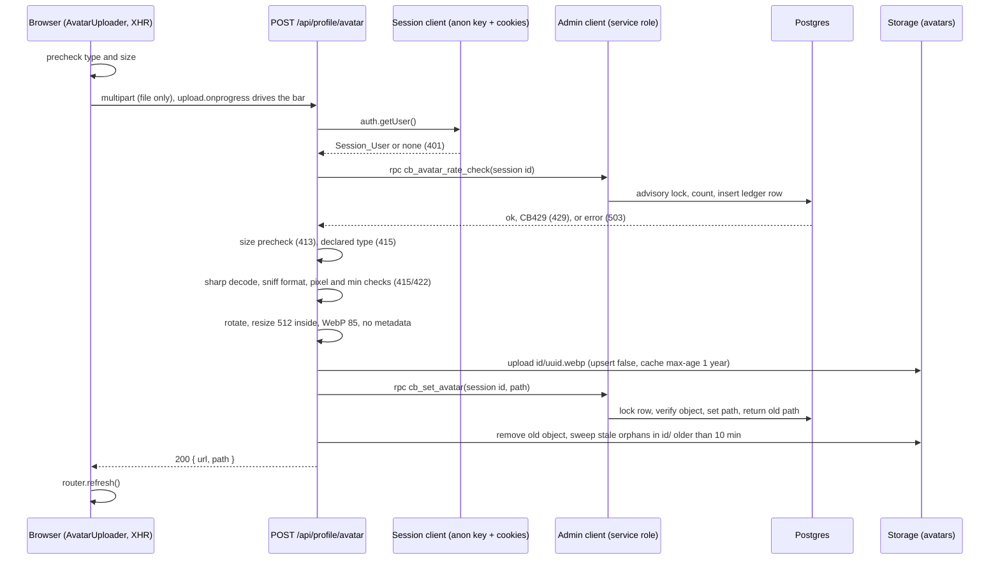

# Design Document

## Overview

Profile photos give each user one optional photo, shown through one shared `Avatar` component beside every @handle. The owner adds, replaces or removes it on `/u/[username]`. Everything that writes goes through a Next.js route handler that derives the user from the verified session. Clients never write the `avatar_path` column or the `avatars` bucket.

Key decisions (the numbered user decisions are applied here):

| Topic | Decision |
|---|---|
| Remove photo | In scope. `DELETE /api/profile/avatar` calls a new service-role-only `cb_clear_avatar(p_user) returns text` (separate from `cb_set_avatar`, which rejects null). **Pending SQL, not applied.** |
| Pixel limit | 50,000,000 decoded pixels (about 8192 by 6144) via sharp `limitInputPixels`, minimum 32 by 32. Over the limit is rejected with a message, never downscaled. One constant (`MAX_INPUT_PIXELS`) the owner can change. The 2 MiB file cap applies first. |
| Output | `.rotate()` first (EXIF orientation), `.resize(512, 512, { fit: "inside", withoutEnlargement: true })`, WebP quality 85, no metadata kept. Always `<user id>/<uuid>.webp`, `image/webp`. Animated input: first frame only. The circle crop is CSS (`object-cover`). |
| Rate limit | Durable ledger `avatar_uploads` plus `cb_avatar_rate_check` with a per-user advisory lock (same pattern as `reply_submissions` and `submit_reply`). 5 per 10 minutes, 20 per 24 hours. Fails closed (503). **Pending SQL, not applied.** |
| Display | Avatars wherever an identity appears, including inbox, thread header and the admin queue. The top bar icon shows the viewer's avatar (cheap: `getViewer` already reads `profiles`). |
| Colors | Photo and Remove controls are secondary: navy border on white, no dark red. The profile page gains no dark-red main action. |

Facts checked in the repo:
- `src/lib/supabase/server.ts` exports `createAdminClient()` (service role, no session). Its only current caller is `src/app/api/auth/sign-up/route.ts`. The file imports `next/headers` but not `server-only`; the plan adds `import "server-only"` to it and to every new avatar module that touches the service role.
- `package.json` has `fast-check 3.23.2`, `vitest 4.1.12`, `server-only`, no `sharp`. The plan adds `"sharp": "0.35.5"` exactly.
- `getViewer()` in `src/lib/auth.ts` selects `profiles.username` for the viewer; `TopBar` passes only a username to `AuthControl`.
- The admin queue data comes from SQL functions that return usernames only. To avoid changing them, the server resolves avatars with one batched `profiles` lookup by username.
- Live database after the user's stage 10 setup: bucket `avatars` (public, 2 MiB, jpeg/png/webp), `profiles.avatar_path` with its path check, column grants limited to `authenticated` insert `(id, username)` and update `(username)`, `cb_set_avatar` (service role only), three restrictive storage policies. The stage 10 SQL file is not in the repo.
- Risk to verify: the narrowed column grants must still leave `anon` and `authenticated` able to SELECT `avatar_path`. The isolated test and the live check both assert this.

## Architecture

### Upload flow



Remove: `DELETE /api/profile/avatar` → session auth → `cb_clear_avatar(session id)` (returns the old path) → Storage remove of the old object → `{ ok: true }`. It uses no ledger allowance.

### Module layout

```
src/lib/avatars/
  constants.ts   MAX_FILE_BYTES, ALLOWED_TYPES, MAX_INPUT_PIXELS, MIN_DIMENSION, OUTPUT_SIZE, WEBP_QUALITY, ORPHAN_AGE_MS, BUCKET
  validate.ts    pure: precheckFile(type, size), checkDimensions(w, h), canManageAvatar(...)
  path.ts        pure: buildAvatarPath(userId, uuid), parseAvatarPath, AVATAR_PATH_RE
  url.ts         pure: avatarUrl(path, base), avatarInitial(username); also safe in client bundles
  errors.ts      error code table and user-facing text (shared by route and client)
  process.ts     server-only: processAvatar(buffer) with sharp
  storage.ts     server-only: upload, remove, sweepOrphans (service-role Storage API only)
  service.ts     server-only: uploadAvatar(deps, userId, file), removeAvatar(deps, userId); injected clients, pure orchestration
src/app/api/profile/avatar/route.ts   POST and DELETE; `runtime = "nodejs"`; thin wrapper over service.ts
src/components/ui/Avatar.tsx          shared display
src/components/ui/AvatarUploader.tsx  owner-only client control
```

`service.ts` takes its Supabase clients as arguments so route tests mock them. Only `route.ts` imports `createAdminClient`.

### Shared Avatar and PosterHandle

`Avatar({ username, avatarPath, size = 24 })`:
- Client component (needs `onError` state), fixed `width` and `height` so the layout never shifts, `loading="lazy"`, `decoding="async"`, `sizes` equal to the pixel size, `alt={`${username}'s profile photo`}`.
- `avatarUrl(path)` builds `NEXT_PUBLIC_SUPABASE_URL + /storage/v1/object/public/avatars/ + path`. Null path or a load error renders the Fallback_Avatar: white circle, 2px navy border, first letter of the username in Kalam Bold, `aria-hidden` removed and `role="img"` with the same alt.
- Round, `object-cover`, so the stored aspect ratio is only cropped visually.

`PosterHandle` gains optional `avatarPath?: string | null` and `avatarSize?`. When the prop is `undefined` (caller has no data) it renders exactly as today, so unconverted callers cannot break. When provided, it renders `<Avatar>` as a sibling before the navy link (not inside it, so the link's accessible name stays the handle). Call sites pass the new prop everywhere in the inventory below.

### Top bar icon

`getViewer()` selects `username, avatar_path` and returns `avatarPath`. `TopBar` passes it to `AuthControl`, which shows the existing white, navy-bordered circle with the viewer's photo, falling back to the current icon. One extra column in a query that already runs: cheap, so yes.

### Query inventory (add `avatar_path`)

| File | Query | Change |
|---|---|---|
| `src/lib/postings.ts` | `POSTING_COLUMNS` embed `profiles!postings_author_id_fkey(username)`; `getProfileByUsername` | `avatar_path`; `Posting.authorAvatarPath`; profile result `avatarPath` |
| `src/lib/connections.ts` | `requester:profiles!…(username)`, `addressee:profiles!…(username)`; plans embed `profiles!plans_user_id_fkey(username)` | add `avatar_path`; people and activity items carry `avatarPath` |
| `src/lib/follows.ts` | `profiles!follows_followee_id_fkey(username)` | add `avatar_path` |
| `src/lib/reactions.ts` | plans `profiles!plans_user_id_fkey(username)` (attendance lists) | add `avatar_path` |
| `src/lib/moderationData.ts` and `src/app/api/postings/[id]/replies/route.ts` | replies `profiles!replies_author_id_fkey(username)` | add `avatar_path`; `ReplyView.authorAvatarPath` |
| `src/app/api/messages/route.ts` | posting author embed (used for recipient checks) | unchanged: avatar not displayed there |
| `src/app/api/messages/threads/route.ts` | `profiles.select("username")` for the other party | add `avatar_path`; response `otherAvatarPath` |
| `src/app/inbox/[id]/page.tsx` | `profiles.select("username")` for the thread header | add `avatar_path` |
| `src/app/api/users/search/route.ts` | `profiles.select("username")` | add `avatar_path`; result `avatarPath` |
| `src/lib/adminData.ts` | SQL functions return usernames only | no SQL change; new `lookupAvatarPaths(supabase, usernames)` does one `profiles` read `in("username", [...])` and the server merges `reporterAvatarPath`, `postingAuthorAvatarPath`, `adminAvatarPath` |
| `src/lib/auth.ts` | `getViewer` | add `avatar_path` |

Rendering call sites (from a search of `PosterHandle`): `PostingCard`, `p/[id]/page.tsx`, `Replies`, `PostingActions` (attendance lists), `u/[username]/page.tsx`, `following/page.tsx`, `friends/page.tsx`, `FriendsManager` (people and search results), plus `inbox/InboxList.tsx`, `inbox/[id]/ThreadView.tsx` header, `inbox/[id]/page.tsx`, and `admin/AdminQueue.tsx`.

### AvatarUploader (client component)

- Rendered by the profile page only when `isSelf && !isSeed`, and receives the current `avatarPath`. It is hidden from everyone else on the server (not just by CSS).
- Labels: "Add profile photo" or "Change profile photo"; "Remove photo" appears only when a photo exists. Each is a 50px-tall control, white with a 2px navy border and navy text. No dark red.
- Visually hidden `<input type="file" accept="image/jpeg,image/png,image/webp">` opened by a real `<button>` (keyboard reachable, visible navy focus ring, 44px minimum target at 390 px).
- Client prechecks use the same `precheckFile` as the server and show specific messages before any network call.
- Upload through `XMLHttpRequest` so `upload.onprogress` drives a `<progress>`-style bar. A ref lock plus `disabled` blocks second submissions. On 200 it shows "Photo updated", then calls `router.refresh()`. The pages read per request, so `revalidatePath` is not needed.
- A polite `aria-live` region carries "Uploading 40%", success and errors (errors use `role="alert"`). The current photo stays displayed through any failure.
- Remove asks for an inline confirm ("Remove your photo? This can't be undone.") with Cancel; the confirming button is navy outline, not dark red.

### Error codes

| Status | `code` | User-facing text |
|---|---|---|
| 401 | `signed_out` | Sign in to change your photo. |
| 400 | `no_file` | Choose a photo to upload. |
| 413 | `too_large` | That file is over 2 MB. Choose a smaller photo. |
| 415 | `unsupported_type` | Use a JPEG, PNG or WebP photo. |
| 422 | `not_an_image` | We couldn't read that file as a photo. Try a different one. |
| 422 | `too_many_pixels` | That photo is larger than 50 million pixels. Choose a smaller one. |
| 422 | `too_small` | That photo is smaller than 32 by 32 pixels. Choose a larger one. |
| 429 | `rate_limited` | Too many tries. Wait a few minutes and try again. (`Retry-After` seconds: 600) |
| 503 | `unavailable` | Photo uploads are unavailable right now. Try again soon. |
| 500 | `failed` | Something went wrong and your photo was not changed. |

The 422 "pixels" text is generated from `MAX_INPUT_PIXELS` so the single constant stays the source of truth.

### Cache strategy

Every upload gets a new UUID filename, so a URL never changes meaning. Objects are uploaded with `cacheControl: "31536000"` (one year; Supabase writes it as `max-age`). No query-string cache busting. After a replace, `router.refresh()` re-reads the profile, which now carries the new path. Removed or replaced objects are deleted, so stale URLs 404 and the Avatar `onError` shows the fallback.

### Failure handling matrix

| Step that fails | Cleaned up | State afterwards |
|---|---|---|
| Not signed in | nothing written | 401 |
| Rate check CB429 / unavailable | nothing written | 429 / 503, image not decoded |
| Precheck / sniff / pixels / decode | nothing written | 4xx; ledger row stays (counts as an attempt) |
| sharp processing throws | nothing written | 422 `not_an_image` or 500 |
| Storage upload fails | nothing stored | 500; photo unchanged |
| `cb_set_avatar` fails | new object deleted (best effort) | 500; photo unchanged |
| Old object delete fails | logged; swept on the next upload | 200; new photo live |
| Orphan sweep fails | ignored | 200 |
| `cb_clear_avatar` fails (remove) | nothing deleted | 500; photo unchanged |
| Old object delete fails (remove) | ignored | 200; the sweep clears it later |
| Process dies after upload before `cb_set_avatar` | object is an orphan | photo unchanged; swept after 10 minutes on the next upload |

Orphan sweep: list `<user id>/` through the Storage API, select objects whose name is not the current path and whose `created_at` is older than 10 minutes (so an in-flight upload from another tab is never deleted), and remove them. Storage API only, never SQL.

### Security model recap

- The route derives the user from `supabase.auth.getUser()` only. Body fields, query string and headers (including `x-user-id`-style names) are never read for identity; the only body field read is `file`.
- The service-role client is created only inside `route.ts` after authentication, in `server-only` modules. No `NEXT_PUBLIC_` variable carries it.
- `avatar_path` is writable only through `cb_set_avatar` and `cb_clear_avatar`, both `service_role` only and both locking the row and taking the user from the argument the server supplies.
- Storage: public read, restrictive policies deny client insert, update and delete. The service role bypasses them.
- Sniffing uses sharp metadata on the bytes, not the filename or the declared type. SVG and GIF are refused even when declared as PNG. `limitInputPixels` is set explicitly (sharp's default is about 268 MP).
- The re-encode removes EXIF and GPS, honouring the privacy rule.
- Rate limit is server-side, durable and serialized per user, and fails closed.

## Components and Interfaces

```ts
// constants.ts
export const BUCKET = "avatars";
export const MAX_FILE_BYTES = 2_097_152;
export const ALLOWED_TYPES = ["image/jpeg", "image/png", "image/webp"] as const;
export const MAX_INPUT_PIXELS = 50_000_000;
export const MIN_DIMENSION = 32;
export const OUTPUT_SIZE = 512;
export const WEBP_QUALITY = 85;
export const ORPHAN_AGE_MS = 10 * 60 * 1000;

// validate.ts
export type Precheck = { ok: true } | { ok: false; code: "unsupported_type" | "too_large" | "no_file" };
export function precheckFile(type: string, size: number): Precheck;
export function checkDimensions(w: number, h: number): { ok: true } | { ok: false; code: "too_small" | "too_many_pixels" };
export function canManageAvatar(viewerId: string | null, profileId: string, isSeed: boolean): boolean;
export function avatarControls(canManage: boolean, avatarPath: string | null): { add: boolean; change: boolean; remove: boolean };

// path.ts
export const AVATAR_PATH_RE: RegExp; // ^<uuid>/<uuid>\.webp$ (the DB constraint also allows jpg|png)
export function buildAvatarPath(userId: string, fileId: string): string;
export function parseAvatarPath(path: string): { userId: string; fileId: string } | null;

// url.ts
export function avatarUrl(path: string | null | undefined, base?: string): string | null;
export function avatarInitial(username: string): string;

// process.ts (server-only)
export type Processed = { buffer: Buffer; width: number; height: number };
export async function processAvatar(input: Buffer): Promise<Processed>; // throws AvatarError

// storage.ts (server-only)
export function selectOrphans(objects: { name: string; created_at: string | null }[], currentName: string | null, now: number): string[];

// service.ts (server-only)
export async function uploadAvatar(deps: Deps, userId: string, file: File | null): Promise<Result>;
export async function removeAvatar(deps: Deps, userId: string): Promise<Result>;
```

`processAvatar`:

```ts
const img = sharp(input, { limitInputPixels: MAX_INPUT_PIXELS, failOn: "error", animated: false });
const meta = await img.metadata();                  // format from bytes
if (!["jpeg", "png", "webp"].includes(meta.format ?? "")) throw new AvatarError("unsupported_type");
const check = checkDimensions(meta.width ?? 0, meta.height ?? 0); // also catches over-limit before decode
if (!check.ok) throw new AvatarError(check.code);
const out = await img.rotate()
  .resize(OUTPUT_SIZE, OUTPUT_SIZE, { fit: "inside", withoutEnlargement: true })
  .webp({ quality: WEBP_QUALITY })                  // no withMetadata(): EXIF, ICC and XMP are dropped
  .toBuffer({ resolveWithObject: true });
```

Note: for an EXIF orientation of 5-8 the pixel width and height are swapped by `rotate()`; the pixel-limit check uses the product, which is unaffected. A sharp error from `limitInputPixels` maps to `too_many_pixels`; any other decode error maps to `not_an_image`. The implementation task confirms the `animated` and `pages` options against sharp 0.35.5 so only the first frame is read.

Route behaviour (`POST`): `getUser` → 401; `formData()` read inside try (a malformed body → 400 `no_file`); early `content-length` above `MAX_FILE_BYTES + 64 KiB` → 413 before reading the body; `file` must be a `File` → else 400; rate check (before decode) → 429/503; `precheckFile(file.type, file.size)` → 415/413; `Buffer.from(await file.arrayBuffer())`; process; upload; `cb_set_avatar`; clean up. The response is `{ ok: true, path, url }`. `DELETE` has no body and reads nothing but the session.

## Data Models

Existing (applied): `profiles.avatar_path text null` with the path check; `public.cb_set_avatar(p_user uuid, p_path text) returns text`; bucket `avatars`.

### Pending SQL (NOT applied; user review required before anyone applies it)

Planned file: `supabase/stage10b_avatar_clear_and_rate_limit.sql`. Companion drafts: `…_preflight.sql`, `…_rollback.sql`, `…_verify.sql`. These are drafts only. Nobody applies them without the owner's review, and the code does not depend on them for ordinary reads.

```sql
-- stage10b_avatar_clear_and_rate_limit.sql  (DRAFT, NOT APPLIED)

-- 1. Clear a photo. service_role only; the route supplies the session user id.
create or replace function public.cb_clear_avatar(p_user uuid)
returns text
language plpgsql
security definer
set search_path = ''
as $$
declare
  v_old text;
begin
  if p_user is null then
    raise exception 'user required' using errcode = 'CB400';
  end if;
  select avatar_path into v_old from public.profiles where id = p_user for update;
  if not found then
    raise exception 'profile not found' using errcode = 'CB404';
  end if;
  update public.profiles set avatar_path = null where id = p_user;
  return v_old;                      -- null when there was no photo
end;
$$;
revoke all on function public.cb_clear_avatar(uuid) from public, anon, authenticated, service_role;
grant execute on function public.cb_clear_avatar(uuid) to service_role;

-- 2. Attempt ledger (same shape as reply_submissions). Rows older than 24 hours are never read.
create table if not exists public.avatar_uploads (
  id          bigint generated always as identity primary key,
  user_id     uuid not null references public.profiles(id) on delete cascade,
  created_at  timestamptz not null default now()
);
create index if not exists avatar_uploads_recent_idx on public.avatar_uploads (user_id, created_at desc);
alter table public.avatar_uploads enable row level security;
revoke all on public.avatar_uploads from anon, authenticated, service_role;

-- 3. Rate check: serialize per user, count, then record the attempt.
create or replace function public.cb_avatar_rate_check(p_user uuid)
returns void
language plpgsql
security definer
set search_path = ''
as $$
begin
  if p_user is null then
    raise exception 'user required' using errcode = 'CB400';
  end if;
  perform pg_advisory_xact_lock(hashtextextended('cb_avatar:' || p_user::text, 0));
  if (select count(*) from public.avatar_uploads
       where user_id = p_user and created_at > now() - interval '10 minutes') >= 5
     or (select count(*) from public.avatar_uploads
          where user_id = p_user and created_at > now() - interval '24 hours') >= 20 then
    raise exception 'rate limited' using errcode = 'CB429';
  end if;
  insert into public.avatar_uploads (user_id) values (p_user);
end;
$$;
revoke all on function public.cb_avatar_rate_check(uuid) from public, anon, authenticated, service_role;
grant execute on function public.cb_avatar_rate_check(uuid) to service_role;

-- 4. Assertions (run immediately after applying; any failure aborts with a clear message).
do $$
begin
  assert has_function_privilege('service_role', 'public.cb_clear_avatar(uuid)', 'execute'), 'service_role must run cb_clear_avatar';
  assert has_function_privilege('service_role', 'public.cb_avatar_rate_check(uuid)', 'execute'), 'service_role must run cb_avatar_rate_check';
  assert not has_function_privilege('anon', 'public.cb_clear_avatar(uuid)', 'execute'), 'anon must not run cb_clear_avatar';
  assert not has_function_privilege('authenticated', 'public.cb_clear_avatar(uuid)', 'execute'), 'authenticated must not run cb_clear_avatar';
  assert not has_function_privilege('anon', 'public.cb_avatar_rate_check(uuid)', 'execute'), 'anon must not run cb_avatar_rate_check';
  assert not has_function_privilege('authenticated', 'public.cb_avatar_rate_check(uuid)', 'execute'), 'authenticated must not run cb_avatar_rate_check';
  assert not has_table_privilege('anon', 'public.avatar_uploads', 'select,insert,update,delete'), 'anon must have no ledger access';
  assert not has_table_privilege('authenticated', 'public.avatar_uploads', 'select,insert,update,delete'), 'authenticated must have no ledger access';
  assert not has_table_privilege('service_role', 'public.avatar_uploads', 'select,insert,update,delete'), 'service_role must have no direct ledger access';
  assert (select relrowsecurity from pg_class where oid = 'public.avatar_uploads'::regclass), 'ledger must have RLS enabled';
  assert not has_column_privilege('authenticated', 'public.profiles', 'avatar_path', 'update'), 'avatar_path must stay unwritable';
  assert not has_column_privilege('authenticated', 'public.profiles', 'avatar_path', 'insert'), 'avatar_path must stay unwritable';
  assert has_column_privilege('anon', 'public.profiles', 'avatar_path', 'select'), 'avatar_path must stay readable';
end $$;
```

Rollback draft (`…_rollback.sql`): `drop function if exists public.cb_avatar_rate_check(uuid); drop function if exists public.cb_clear_avatar(uuid);` and nothing else. The `avatar_uploads` table and its rows are kept. After this rollback, deployed code that calls these functions fails closed (upload 503, remove 500), so roll the code back first or together.

Preflight draft: checks that `cb_set_avatar` exists with the expected grants, that `profiles.avatar_path` and its constraint exist, and that neither new object already exists. Verify draft: the assertions above plus behaviour in a rolled-back transaction (clear returns the old path and nulls it; clear on an unknown user raises CB404; the sixth call within 10 minutes raises CB429; the 21st within 24 hours raises CB429).

Rate-limit semantics: an attempt is recorded inside the same transaction as the check, so concurrent requests serialize on the advisory lock and are counted exactly. A failed attempt keeps its row (the RPC commits before decoding), which bounds sharp CPU.

## Correctness Properties

*A property is a characteristic or behavior that should hold true across all valid executions of a system-essentially, a formal statement about what the system should do. Properties serve as the bridge between human-readable specifications and machine-verifiable correctness guarantees.*

### Property 1: Upload precheck accepts exactly valid files

For any declared type string and any integer size, `precheckFile` accepts if and only if the type is `image/jpeg`, `image/png` or `image/webp` and 0 < size ≤ 2,097,152; otherwise it returns a rejection code naming the cause.

**Validates: Requirements 2.1, 2.2, 2.3, 2.11**

### Property 2: Dimension rule

For any integer width and height, `checkDimensions` accepts if and only if both are at least 32 and width × height is at most 50,000,000; a rejection is `too_small` or `too_many_pixels` accordingly.

**Validates: Requirements 2.9, 2.10**

### Property 3: Avatar path builder and parser round trip

For any user UUID and file UUID, `parseAvatarPath(buildAvatarPath(u, f))` returns `{ userId: u, fileId: f }`, the path matches the `profiles` check pattern with first segment equal to `u`, and two different file UUIDs give two different paths.

**Validates: Requirements 4.4, 5.2, 7.1**

### Property 4: Processed output invariants

For any generated valid JPEG, PNG or WebP of valid dimensions (including EXIF orientation values 1 to 8), `processAvatar` returns WebP with no EXIF, ICC or XMP metadata, both dimensions at most 512, the aspect ratio of the oriented input preserved within one pixel of rounding, no upscaling of images already within 512, and a size no greater than 2 MiB; processing the output again leaves the dimensions unchanged.

**Validates: Requirements 3.1, 3.3, 3.4, 3.5, 3.7**

### Property 5: Target user is always the session user

For any session user and any other user id, username or storage path placed in the body fields, query string or headers of a POST or DELETE request, every database call, Storage call and object path produced by the route uses the session user's id only; and for any request with no session, the route returns 401 and makes no database or Storage call.

**Validates: Requirements 4.1, 4.2, 4.3, 12.4, 12.5**

### Property 6: Failure never loses the current photo

For any single failing step in the upload or remove pipeline (rate check excluded), the mock profile's `avatar_path` equals its value before the request, any object uploaded by that request is deleted, and the current object is not deleted.

**Validates: Requirements 7.3, 7.4, 12.10**

### Property 7: Orphan selection

For any list of objects in a user's folder, any current path (or none) and any time, `selectOrphans` returns exactly the objects that are not the current object and are older than 10 minutes, and never the current object or a newer object.

**Validates: Requirements 7.6**

### Property 8: Rate-check outcome mapping

For any rate-check outcome (success, error code `CB429`, any other error code, a thrown exception), the route responds 429 with a `Retry-After` header for `CB429`, 503 for every other failure, and the image decoder is invoked only after success.

**Validates: Requirements 13.1, 13.5, 13.6, 13.7**

### Property 9: Avatar URL and fallback

For any valid avatar path and base URL, `avatarUrl` returns the base plus `/storage/v1/object/public/avatars/` plus the path; for a null path it returns null; for any valid username `avatarInitial` returns the uppercased first character.

**Validates: Requirements 8.2, 8.3, 8.9**

### Property 10: Control visibility

For any viewer id (or none), profile id, seed flag and avatar path, the add or change control is visible if and only if the viewer id equals the profile id and the profile is not a seed profile, with the label "Add" when the path is null and "Change" otherwise; and the remove control is visible if and only if those conditions hold and the path is non-null.

**Validates: Requirements 1.1, 1.2, 1.3, 1.4, 12.1, 12.2, 12.3**

## Error Handling

- The route returns the table in Architecture with JSON `{ ok: false, code, message }`. Messages never include internals.
- `AvatarError(code)` is thrown by pure helpers and by `processAvatar`; `service.ts` maps it to a status. Unknown exceptions become 500 `failed`, logged server-side without file contents or tokens.
- The rate check runs before decode, and an unknown error from it is 503. The check is never skipped.
- The client shows the server's `message` for a known `code`, and a generic failure text for a network error or an unparseable body. It keeps the current photo in every case.
- Avatar load failure falls back to the initial letter and never throws.

## Testing Strategy

Property-based testing applies to the pure helpers, the sharp pipeline, and the route logic with mocked clients. It does not apply to the SQL, Storage policies or live behaviour, which use integration and live checks. UI rendering uses example tests.

Libraries: `vitest` 4.1.12 and `fast-check` 3.23.2 (already installed). Each property is one test with at least 100 runs (`numRuns: 100`; Property 4 uses tiny generated images, at most 64 pixels per side, so 100 runs stay fast). Tag each test: `Feature: profile-photos, Property N: <title>`.

Unit and route tests (example-based):
- Route tests with mocked Supabase (the existing `route.test.ts` style, `vi.mock("server-only", () => ({}))`): signed-out POST and DELETE 401; foreign id in body, query and headers (Property 5); invalid type, over-size by one byte (2 MiB + 1), undecodable bytes; upload options include `upsert: false`, `contentType: "image/webp"` and the cache control; DELETE never calls the rate check.
- Sharp fixtures generated in the tests (no binary files committed): a JPEG with GPS EXIF whose output has no EXIF; a text file or renamed `.exe` declared `image/png` is rejected; SVG and GIF rejected even when declared PNG; oversized pixel dimensions rejected through `limitInputPixels`; a 31-pixel image rejected; orientation 6 swaps dimensions; an animated WebP yields one frame.
- Component example tests for `Avatar` (fallback on null path and on `onError`, alt text) and `AvatarUploader` states, and a source scan that every query in the inventory selects `avatar_path`.
- Smoke test that `SUPABASE_SERVICE_ROLE_KEY` is never read in a `NEXT_PUBLIC_` name or a client module.

Isolated PostgreSQL (`supabase/isolated-test`, which already provides embedded Postgres with Supabase-like roles): add a stub `storage` schema (`storage.objects` with `bucket_id`, `name`, `metadata`) and the `profiles` columns, grants and constraint. Run the pending SQL, then assert: grants and RLS (the assertion block above), `cb_clear_avatar` returns the old path and nulls it, `cb_clear_avatar` and `cb_avatar_rate_check` refuse `anon` and `authenticated`, the sixth attempt within 10 minutes raises CB429, a concurrent burst of calls from separate sessions counts exactly, and the rollback keeps ledger rows. These tests need the pending SQL and run only locally; they never touch production.

Live verification (local `next dev` against the production Supabase project, no deployment): two disposable accounts created with the Supabase admin API (`email_confirm: true`) and deleted afterwards, following the cleanup pattern recorded in `BUILD_LOG.md` for stages 8 and 9 (baseline counts and hashes, labelled `[TEST]`, delete only what the setup recorded). A real browser run covers first upload, replacement, invalid types, oversized, fallback and failed-image display, refresh persistence, avatar consistency across the pages in the inventory, 390 px layout, remove photo and a username-edit regression. Cross-account checks use direct REST, RPC and Storage calls with the second account's JWT: `profiles` PATCH of `avatar_path`, RPC `cb_set_avatar` and `cb_clear_avatar`, and Storage insert, update and delete in the first account's folder, all of which must be refused. The rate-limit live test and the remove-photo live test are BLOCKED until the owner reviews and applies the pending SQL.

Records go in `BUILD_LOG.md` as pass, fail or untested, with no credentials, emails or tokens. Nothing is deployed, committed or pushed without the owner's approval.
